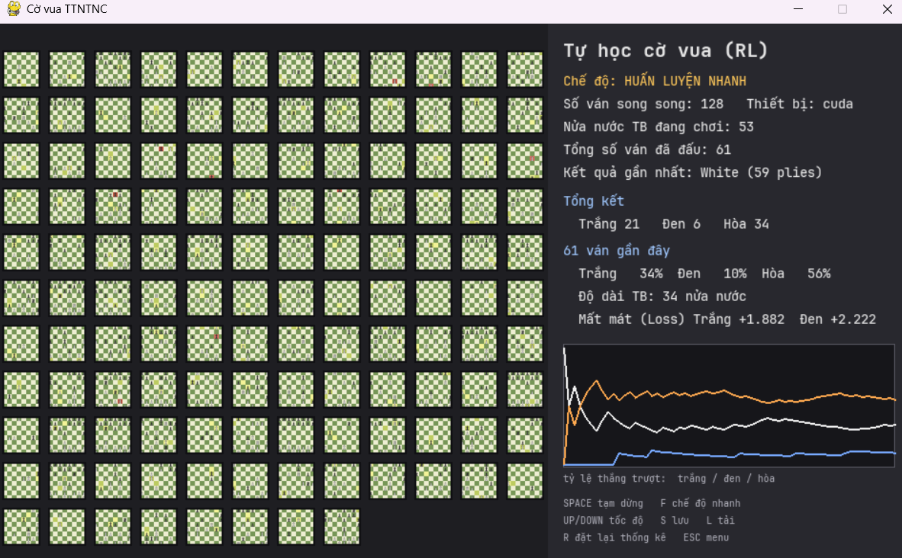

# Cờ Vua Học Tăng Cường

Ứng dụng cờ vua Pygame kết hợp giao diện chơi cờ, huấn luyện tự đối kháng và nhiều thuật toán reinforcement learning:

- **A2C** - Advantage Actor-Critic
- **PPO** - Proximal Policy Optimization
- **DQN** - Deep Q-Network
- **AlphaZero** - policy/value network kết hợp Monte Carlo Tree Search

Mã nguồn hiện tại nằm trong `src/`. Các agent dùng cùng mạng policy/value cho cả hai phe và có các đầu dự đoán:

- policy cho các nước đi hợp lệ
- value cho trạng thái bàn cờ
- opponent policy
- opening/middlegame/endgame phase

## Showcase

| Chơi cờ | Huấn luyện |
|---|---|
|  |  |

## Tính năng

### Chơi cờ

- Người vs Người
- Người vs AI
- AI vs AI
- Tải checkpoint `.pt`
- Chơi với người chơi ngẫu nhiên khi không chọn mô hình
- Chọn nước đi theo xác suất (**Sampling**) hoặc theo điểm cao nhất (**Greedy**)
- **Opponent-aware lookahead** để dự đoán các nước đáp trả có khả năng cao
- Ghi kết quả Người vs AI: nhấn `R` để bắt đầu, `X` để dừng (không xóa kết quả đã ghi), `S` để lưu; kết quả tự lưu mỗi 2 phút vào `checkpoints/game_records/`. Với AI vs AI, nhấn `R` để chọn đấu một ván hoặc kiểm thử `NUM_GAMES` ván đồng thời; kết quả được lưu sau mỗi ván.
- Vẽ biểu đồ kết quả từ JSON:

  ```powershell
  python src\plot_logging\record_plot.py
  python src\plot_logging\record_plot.py checkpoints\game_records\game_results_YYYYMMDD_HHMMSS_ffffff.json
  ```

### Huấn luyện

- Huấn luyện từng ván một
- Huấn luyện nhiều ván song song
- 128 bàn cờ mặc định trong chế độ song song
- Curriculum cho opening, middlegame và endgame
- Tiếp tục huấn luyện từ checkpoint hoặc bắt đầu mô hình mới
- Tự lưu checkpoint và chỉ số huấn luyện
- Kiểm tra mate-in-one, tránh chiếu hết, bắt quân tự do và chuyển đổi tàn cuộc
- Ghi log và vẽ reward, loss, entropy, win/draw rate, Elo và throughput
- Theo dõi Elo Trắng/Đen trong lúc huấn luyện; xem cách tính và vị trí lưu trong mục [Elo](#elo).
- AlphaZero có thể dùng native Rust MCTS thay cho MCTS Python

### Teacher và Coach với Stockfish

- Tạo dữ liệu tiền huấn luyện từ nước đi và đánh giá của Stockfish
- Tiền huấn luyện mạng AlphaZero hoặc DQN từ dữ liệu đã tạo
- Dùng đánh giá Stockfish làm reward-shaping trong quá trình huấn luyện

## Elo

Điểm Elo được cập nhật sau mỗi ván bằng công thức Elo chuẩn, với mức khởi đầu `1200` cho mỗi bên và hệ số K=`32`. Kết quả thắng, hòa, thua lần lượt được tính là `1`, `0.5`, `0`. Điểm Trắng và Đen là một cặp tương đối trong cùng phiên đấu; đây không phải xếp hạng FIDE hay điểm đã hiệu chuẩn để so sánh giữa các phiên/mô hình khác nhau.

- **Huấn luyện:** Elo của hai mô hình cập nhật sau mỗi ván và hiển thị trên bảng huấn luyện. Nhấn `R` để đặt lại thống kê cũng đặt Elo về `1200`. Giá trị được lưu trong `metrics.json` (trường `training.elo`) và từng hàng `training_log.csv` (`white_elo`, `black_elo`); biểu đồ huấn luyện vẽ Elo theo thời gian.
- **Kiểm thử:** Elo cập nhật cho hai bên trong mỗi phiên ghi kết quả. Với Người vs AI, bắt đầu ghi bằng `R`; với AI vs AI, nhấn `R` rồi chọn đấu một ván hoặc kiểm thử nhiều ván. Điểm hiện trên giao diện và được lưu trong JSON (`totals.elo` và `games[].elo`); biểu đồ kết quả hiển thị đường Elo theo số ván.

## Kiến trúc mạng hiện tại

Các giá trị mặc định được lấy trực tiếp từ `src/encoding.py` và `src/model.py`.

| Thành phần | Giá trị |
|---|---|
| Lịch sử trạng thái | 4 thế cờ |
| 12 mặt quân cờ cho mỗi lịch sử | 48 mặt |
| Mặt metadata | 8 mặt |
| Kích thước tensor đầu vào | `56 x 8 x 8` |
| Không gian hành động | 16.384 |
| Residual blocks mặc định | 4 |
| Channels mặc định | 32 |
| Kiến trúc | Policy/Value Residual CNN |
| Ván tối đa mặc định | 300 nửa nước |

Không gian hành động gồm:

- `64 x 64 = 4.096` cặp ô đi - ô đến
- 3 x `4.096` mặt phong hậu, xe, tượng
- 1 x `4.096` mặt phong mã

Mỗi phe được lưu dưới dạng checkpoint riêng với tên `white_<thuật toán>.pt` hoặc `black_<thuật toán>.pt`.

> Checkpoint chỉ tương thích khi metadata checkpoint và kiến trúc mạng khớp với mã nguồn hiện tại. Nếu checkpoint cũ không thể nạp, hãy bắt đầu một lần huấn luyện mới.

## Cấu trúc thư mục

```text
src/
├── main.py                     # Điểm khởi chạy Pygame
├── menu_scene.py               # Chọn chế độ và cấu hình mô hình
├── play_scene.py               # Chế độ chơi
├── match.py                    # Quản lý trận đấu
├── players.py                  # Human, random và model players
├── encoding.py                 # Tensor bàn cờ 56 x 8 x 8 và action mapping
├── model.py                    # Residual policy/value network
├── strategy.py                 # Opponent model và lookahead
├── curriculum.py               # Opening/middlegame/endgame
├── skill_eval.py               # Kiểm tra kỹ năng
├── checkpoints.py              # Lưu checkpoint và metrics
├── metrics.py                  # Thống kê huấn luyện
├── algorithms/                 # A2C, PPO, DQN và AlphaZero
├── algorithms-rs/              # Các implementation thuật toán dùng Native Rust 
├── normal_mode/                # Huấn luyện một ván
├── concurrent_mode/            # Huấn luyện song song
├── plot_logging/               # Ghi log và vẽ biểu đồ
├── stockfish/                  # Teacher và Coach với Stockfish
├── pretraining/                # Broadcast pre-training và export checkpoint
└── tests/                      # Unit test

assets/chess_pieces/            # Hình quân cờ PNG
checkpoints/                    # Checkpoint và metrics theo từng experiment
```

## Yêu cầu

- Python 3.10 trở lên
- Pygame
- PyTorch
- NumPy
- python-chess
- zstandard
- Matplotlib, pandas, seaborn
- Stockfish chỉ cần khi sử dụng teacher/coach
- Rust/Cargo và maturin chỉ cần khi build native MCTS

Tạo môi trường ảo và cài các thư viện Python:

```powershell
python -m venv .venv
.venv\Scripts\Activate.ps1
python -m pip install pygame torch numpy matplotlib pandas seaborn python-chess zstandard
```

Nếu máy có NVIDIA GPU, cài PyTorch với build CUDA phù hợp để tăng tốc huấn luyện. GPU là tùy chọn.

## Chạy ứng dụng

Luôn chạy từ thư mục gốc của repository:

```powershell
python src\main.py
```

Ứng dụng có thể chạy bằng CPU hoặc GPU; PyTorch sẽ tự chọn CUDA khi thiết bị tương thích khả dụng.

## Điều khiển

### Menu

1. Chọn một trong năm chế độ ở thanh nút phía trên.
2. Nhấp chuột trái vào các hàng để chuyển tùy chọn hoặc chọn checkpoint.
3. Nhấp chuột phải vào hàng mô hình để quay lại lựa chọn trước hoặc bỏ mô hình đã chọn.
4. Nhấn **BẮT ĐẦU** hoặc `Enter`.
5. Nhấn `Esc` để thoát.

Trong các chế độ chơi:

- Nhấp một quân cờ, sau đó nhấp ô được làm sáng để đi quân.

Trong các chế độ huấn luyện:

- `Space`: tạm dừng/tiếp tục
- `F`: bật/tắt chế độ huấn luyện nhanh
- `Up` / `Down`: điều chỉnh độ trễ
- `S`: lưu checkpoint
- `L`: tải checkpoint
- `R`: đặt lại thống kê
- `M`: bật/tắt panel metrics
- `Esc`: lưu checkpoint và quay lại menu

## Huấn luyện và checkpoint

Mở:

- `Huấn luyện: 1 ván`
- `Huấn luyện: 128 ván`

Sau đó chọn checkpoint ở các hàng **Tệp mô hình Trắng** hoặc **Tệp mô hình Đen**:

- Nhấp trái: chọn checkpoint `.pt`
- Nhấp phải: bỏ checkpoint và khởi tạo mô hình mới

Thuật toán tương ứng được đọc từ metadata checkpoint. Checkpoint mới được lưu tại:

```text
checkpoints/exp_YYYYMMDD_HHMMSS/
├── white_<algorithm>.pt
├── black_<algorithm>.pt
├── metrics.json
└── training_log.csv
```

Ứng dụng cũng tự lưu định kỳ và lưu checkpoint trước khi thoát màn hình huấn luyện bằng `Esc`.

## Xem kết quả huấn luyện

Vẽ biểu đồ từ log mới nhất:

```powershell
python src\plot_logging\plot_training.py
```

Hoặc chỉ định một log cụ thể:

```powershell
python src\plot_logging\plot_training.py checkpoints\exp_YYYYMMDD_HHMMSS\training_log.csv
```

`training_log.csv` lưu loss, reward, entropy, win/draw rate, Elo, repetition, độ dài ván, throughput, nguyên nhân hòa và timing từng giai đoạn. Biểu đồ huấn luyện có đường Elo Trắng/Đen theo thời gian. `metrics.json` lưu các thống kê tổng hợp của experiment, bao gồm Elo hiện tại của hai bên.

## Native Rust MCTS cho AlphaZero

Từ thư mục `src/algorithms-rs`:

```powershell
pip install maturin
python -m pip install .
```

Sau đó bật native search:

```powershell
$env:CHESS_AI_RUST_SEARCH = "1"
python src\main.py
```

Backend tùy chọn:

| Biến môi trường | Hành vi |
|---|---|
| `CHESS_AI_RUST_SEARCH=1` | Rust xử lý luật cờ, mã hóa, cây tìm kiếm, chọn nhánh và backup |
| `CHESS_AI_RUST_MCTS=1` | Backend cây Rust cũ; chỉ PUCT/expand/backup chạy trong Rust |

Nếu biến được bật nhưng extension chưa được cài, chương trình sẽ báo lỗi rõ ràng thay vì im lặng chuyển sang Python.

Để chạy hoàn toàn bằng MCTS Python:

```powershell
$env:CHESS_AI_RUST_SEARCH = "0"
$env:CHESS_AI_RUST_MCTS = "0"
python src\main.py
```

Chi tiết backend và test parity nằm trong [src/algorithms-rs/README.md](src/algorithms-rs/README.md).

## Stockfish Teacher và Coach

Tải tệp thực thi native/UCI của Stockfish, sau đó cấu hình:

```powershell
$env:STOCKFISH_PATH = "C:\path\stockfish.exe"
```

Có thể bỏ biến này nếu `stockfish.exe` đã nằm trong `src\stockfish` hoặc `stockfish` đã nằm trong `PATH`. Ứng dụng không tự tải hoặc sao chép binary Stockfish.

Tạo dữ liệu và tiền huấn luyện từ thư mục gốc:

```powershell
python src\stockfish\pretrain_stockfish.py generate --out data\sf.npz --games 2500 --workers 10 --nodes 50000
python src\stockfish\pretrain_stockfish.py train --data data\sf.npz --algorithm AlphaZero --color white --epochs 6 --lr 1e-3
python src\stockfish\pretrain_stockfish.py train --data data\sf.npz --algorithm DQN --color black --epochs 6 --lr 1e-3
```

Sau khi tạo dữ liệu, kiểm tra ranh giới tập holdout:

```powershell
python src\stockfish\pretrain_stockfish.py inspect --data data\sf.npz --holdout 0.1 --seed 0
python src\stockfish\pretrain_stockfish.py train --data data\sf.npz --algorithm AlphaZero --color both --epochs 6 --holdout 0.1 --seed 0
```

Hoặc chạy huấn luyện với Stockfish làm nguồn reward:

```powershell
$env:CHESS_AI_STOCKFISH_COACH = "1"
$env:CHESS_AI_STOCKFISH_COACH_NODES = "2000"
python src\main.py
```

Chi tiết nằm trong [src/stockfish/STOCKFISH.md](src/stockfish/STOCKFISH.md).

## Broadcast Pre-training Pipeline

Pipeline tiền huấn luyện mới tại `src/pretraining` huấn luyện một `PolicyValueNet` chung trên dữ liệu broadcast của Lichess. Mô hình học cả Policy (nước đi được chơi) và Value (kết quả ván cờ kết hợp đánh giá Stockfish), sau đó được xuất thành checkpoint tương thích với AlphaZero, DQN, PPO và A2C.

Luồng tiền huấn luyện gồm:

```text
Lichess Broadcast PGN
  -> download
  -> prepare / lọc Elo và chia shard
  -> gán nhãn Stockfish hoặc Eval Join
  -> train PolicyValueNet
  -> export checkpoint theo thuật toán và màu quân
```

Cài thư viện bổ sung và chạy pipeline từ thư mục `src/pretraining`:

```powershell
cd src\pretraining
python -m pip install python-chess zstandard numpy torch
```

### 1. Tải dữ liệu

Tải các tệp broadcast theo tháng hoặc theo khoảng tháng:

```powershell
python -m pretrain.download --months 2026-01 --out data\raw
python -m pretrain.download --from 2026-01 --to 2026-03 --out data\raw
```

### 2. Chuẩn bị shard

Lọc Elo, độ dài ván, nước đi không hợp lệ, ván ngắn, biến thể không chuẩn và dữ liệu trùng lặp:

```powershell
python -m pretrain.prepare data\raw\lichess_db_broadcast_2026-01.pgn.zst `
  --out data\shards `
  --min-elo 2000
```

### 3. Gán nhãn

Chạy Stockfish cho các vị trí trong shard:

```powershell
python -m pretrain.stockfish_label data\shards `
  --out data\labeled `
  --engine C:\path\stockfish.exe `
  --nodes 5000 `
  --every 4 `
  --workers 8
```

Hoặc dùng dữ liệu đánh giá có sẵn từ Lichess thay cho phân tích Stockfish:

```powershell
python -m pretrain.eval_join data\shards `
  --evals data\lichess_db_eval.jsonl.zst `
  --out data\labeled
```

### 4. Tiền huấn luyện

```powershell
python -m pretrain.train `
  --shards data\labeled `
  --out runs\pre1 `
  --epochs 4 `
  --batch 512 `
  --workers 6 `
  --policy-min-elo 2300 `
  --sf-value-weight 0.7 `
  --w-sf 0.3
```

Giá trị `--sf-value-weight` kết hợp kết quả thực của ván và đánh giá Stockfish cho Value target. Pipeline tự chọn CPU hoặc CUDA, lưu `last.pt` và checkpoint tốt nhất `best.pt`, đồng thời chia Train/Validation theo giải đấu để giảm rò rỉ dữ liệu.

### 5. Xuất checkpoint

```powershell
python -m pretrain.export `
  --ckpt runs\pre1\best.pt `
  --out models `
  --algorithms alphazero dqn ppo a2c
```

Mỗi thuật toán được xuất thành checkpoint riêng cho cả hai màu quân:

```text
src/pretraining/models/
├── white_alphazero.pt
├── black_alphazero.pt
├── white_dqn.pt
├── black_dqn.pt
├── white_ppo.pt
├── black_ppo.pt
├── white_a2c.pt
└── black_a2c.pt
```

Các checkpoint này có thể chọn trong giao diện huấn luyện để tiếp tục huấn luyện bằng thuật toán tương ứng.

Chạy unit test pipeline bằng dữ liệu tổng hợp:

```powershell
cd src\pretraining
python -m unittest tests.test_pretrain -v
```

Chi tiết kỹ thuật nằm trong [src/pretraining/README.md](src/pretraining/README.md).

## Kiểm tra mã nguồn

Chạy các test Python:

```powershell
cd src
python -m compileall -q .
python -m unittest discover -s tests -v
```

Kiểm tra native Rust nếu đã build extension:

```powershell
cd src\algorithms-rs
cargo test

cd ..
python -m unittest tests.test_rust_search
```
