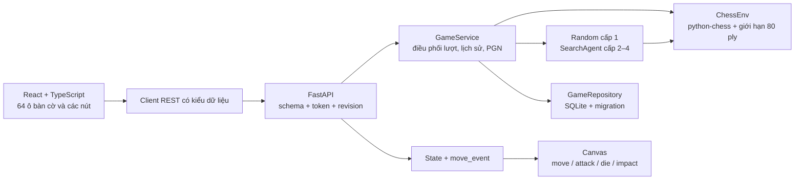

# Thiết kế hệ thống Cờ Vua

## Bản đang triển khai

Một người đấu máy với bốn độ khó, hoặc hai người trên cùng thiết bị. Frontend gồm menu chọn trận và màn chơi tập trung vào bàn cờ. Backend xác nhận luật, lượt, độ khó và kết quả; React diễn hoạt trạng thái bằng bộ sprite có sẵn.



Node.js chạy Vite khi phát triển/build, không cần máy chủ Node thứ hai để chơi bản build. FastAPI phục vụ `frontend/dist` và API trên cùng cổng 8000.

## Ranh giới các lớp

| Lớp | Trách nhiệm | Tệp chính |
|---|---|---|
| Giao diện | Ô hợp lệ, click/kéo thả, hộp thoại, cài đặt, lịch sử | `frontend/src/App.tsx` |
| Luồng ván | Nạp phiên, gọi API, khóa thao tác khi đang xử lý, kích hoạt AI | `frontend/src/game/useGame.ts` |
| Diễn hoạt | Vẽ sprite, nội suy đường đi, ghép hiệu ứng và quân bị ăn | `frontend/src/game/Board.tsx` |
| API | Xác thực dữ liệu, đọc token, trả lỗi có mã | `backend/api/server.py`, `backend/api/games/schemas.py` |
| Nghiệp vụ | Kiểm tra lượt, seed, undo, dừng/chơi tiếp, PGN | `backend/api/games/service.py` |
| Luật và môi trường | Nước hợp lệ, thắng/hòa, tensor, clone/undo | `backend/core/env.py` |
| AI | Random, đánh giá 1 ply, alpha-beta 2/4 ply có hạn thời gian | `backend/agents/level1_random.py`, `backend/agents/search_agent.py` |
| Học máy | Mã hóa trạng thái, MLP/CNN, huấn luyện, TD(0), đấu thử | `model/learning/encoding.py`, `model/learning/models.py`, `model/learning/train.py` |
| Lưu trữ | Giao dịch, bản băm token, kiểm tra revision | `backend/api/games/repository.py` |

## Dữ liệu và phiên

SQLite có bảng `games(id, token_hash, version, body, updated_at)`. `body` lưu FEN khởi đầu, danh sách nước UCI, chế độ, phía người chơi, seed và trạng thái RNG, cờ tạm dừng, thời lượng và kết quả kết thúc thủ công. Trạng thái bàn được dựng lại từ FEN và lịch sử khi đọc. Với giới hạn 80 ply, cách này đơn giản và giữ đúng lịch sử phục vụ luật lặp lại.

Khi tạo ván, API trả token ngẫu nhiên một lần. Các lời gọi của ván gửi `Authorization: Bearer <token>`. DB chỉ lưu SHA-256 của token. Mỗi thay đổi gửi `revision`; SQLite dùng giao dịch `BEGIN IMMEDIATE` để so sánh rồi tăng phiên bản. Hai yêu cầu trùng revision không cùng ghi đè trạng thái; yêu cầu đến sau nhận `409 STALE_STATE`.

Phiên hiện tại được lưu trong localStorage. Tải lại trang gọi GET để khôi phục. Các thay đổi không tự gửi lại khi mất kết nối, tránh vô tình thực hiện một nước hai lần; người chơi có thể tải lại trạng thái để biết máy chủ đã nhận hay chưa.

## API chính

| Phương thức | Đường dẫn | Chức năng |
|---|---|---|
| POST | `/api/reset` | Tạo ván mới; trả `game_id`, `token`, `state` |
| GET | `/api/games/{id}` | Đọc trạng thái hiện tại |
| POST | `/api/human-move` | Gửi nước UCI của người chơi |
| POST | `/api/ai-move` | Thực hiện một nước theo độ khó đã lưu của ván |
| POST | `/api/undo` | Hoàn tác một lượt người + máy, hoặc một ply ở chế độ hai người |
| POST | `/api/pause` | Tạm dừng/tiếp tục và cập nhật đồng hồ |
| POST | `/api/finish` | Đầu hàng hoặc kết thúc hòa sau xác nhận UI |
| GET | `/api/games/{id}/hint` | Một gợi ý ngẫu nhiên, không tiêu thụ RNG của máy |
| GET | `/api/games/{id}/pgn` | Xuất PGN có FEN khởi đầu nếu cần |
| GET | `/api/tournament-results` | Trả danh sách rỗng và `available: false` vì chưa có giải đấu |
| GET | `/health`, `/ready` | Kiểm tra tiến trình và kết nối dữ liệu |

Ví dụ tạo ván:

```json
{"mode":"ai","human_color":"white","seed":42}
```

`mode` nhận `ai` hoặc `local`; `human_color` nhận `white` hoặc `black`. `fen` là tùy chọn và phải là thế cờ hợp lệ. Seed nằm trong khoảng 0–4294967295, bỏ trống sẽ tạo seed mới.

Ví dụ đi quân (kèm Bearer token ở header):

```json
{"game_id":"<uuid từ reset>","revision":0,"uci":"e2e4"}
```

Khi tạo ván, `level` nhận 1–4, mặc định 1. Yêu cầu AI có thể gửi lại level để kiểm tra khớp với ván, không được đổi độ khó giữa ván. `time_ms` tùy chọn giới hạn ngân sách tìm kiếm; mặc định cấp 2/3/4 dùng tối đa 180/600/1400 ms. Random chọn ngay. Các thay đổi trả `{game_id, state, telemetry, move}`; state chứa thêm level. Nước phong cấp có hậu tố UCI `q/r/b/n`.

Lỗi có dạng `{error: {code, message}, request_id}`; lỗi dữ liệu thêm `fields`. Các trường hợp chính: 401 token sai, 404 ván không tồn tại, 409 revision cũ/sai lượt/đã kết thúc, 422 dữ liệu hoặc nước đi không hợp lệ. Xem `/docs` để thử hợp đồng đang chạy.

## Luồng một lượt

1. Chọn quân → UI lọc `legal_actions` đã nhận từ máy chủ và tô các ô đích.
2. Chọn đích → nếu cần thì mở hộp phong cấp; gửi nước UCI cùng revision.
3. Backend xác nhận token, phiên bản, trạng thái ván, lượt và tính hợp lệ; tạo `move_event` **trước khi** đẩy nước.
4. Ghi lịch sử và trạng thái mới trong một giao dịch; trả state mới cùng event.
5. UI giữ ảnh chụp bàn trước nước đi để chạy animation; chặn nước mới trong lúc diễn hoạt.
6. Nếu đến lượt máy, gọi `/api/ai-move` một lần. Máy chỉ chọn trong danh sách hợp lệ; UI tiếp tục cùng quy trình animation.

Undo ở chế độ AI quay về trước nước gần nhất của người chơi, bỏ cả nước đáp của máy nếu đã có. RNG được khôi phục tương ứng để chơi lại cùng nước vẫn nhận cùng đáp án với seed đó. Khi người cầm Đen, nước mở đầu duy nhất của máy không thể undo riêng vì máy phải đi trước.

## Animation

`manifest.json` là nguồn cấu hình frame/điểm neo. Mỗi quân có 4 frame cho `move`, `attack`, `die`. Idle lặp đủ bốn frame đã căn của cùng nhân vật với nhịp riêng, thêm chuyển động thở, vòng sáng và hai hạt nhỏ. Không dùng các ảnh idle cũ có nền đặc. Hai texture `impact` theo màu được ghép riêng, không chèn hình lạ vào sheet quân.

Nước đi thường nội suy 650–1100 ms theo khoảng cách, có vệt sáng; Mã nhảy theo cung. Ăn quân kéo dài 1760 ms: tiến tới mục tiêu, ra đòn ở 480 ms, va chạm và bắt đầu `die` ở 760 ms, quân tấn công tới đích ở 1160 ms, nạn nhân tan hết ở 1620 ms. Với bắt tốt qua đường, event chứa đúng ô nạn nhân; nhập thành diễn hoạt cả Vua và Xe; phong cấp chuyển sprite ở cuối quỹ đạo.

Animation hoàn tất bằng callback từ renderer sau khung cuối đã vẽ; không dùng timeout bắt đầu từ lúc nhận API. Đồng hồ animation giữ tiến độ khi đổi cách nhìn và không bỏ qua toàn bộ hiệu ứng khi tab bị ẩn rồi mở lại. Idle vẽ tối đa 30 fps, dừng khi tạm dừng ván hoặc ẩn tab; animation của nước đi dùng requestAnimationFrame. Có ba chế độ: `full` do người chơi chọn để phát đầy đủ, `system` tôn trọng yêu cầu giảm chuyển động của thiết bị, và `off`. UI nêu rõ khi hiệu ứng đang tắt/giảm và cho bật lại.

Canvas chỉ vẽ lớp hình ảnh; 64 nút DOM bên dưới giữ thao tác, tọa độ, trạng thái ô và hỗ trợ bàn phím. Máy chủ không biết tọa độ pixel hoặc tốc độ animation.

## Hướng mở rộng

Thêm agent kế thừa `BaseAgent`, dùng cùng `ChessEnv` và hợp đồng telemetry. Các agent tìm kiếm có thể dùng `clone()/undo()`; bản clone giữ lịch sử để không mất luật hòa do lặp lại. Sau khi có agent thật, mới mở thêm mức khó trong schema và giao diện. Chạy giải đấu nên thành tác vụ riêng và ghi kết quả thực, không đặt dữ liệu minh họa vào endpoint hiện có.

Nếu phát triển chơi online, cần bổ sung tài khoản/phòng, phân quyền hai phía và cơ chế cập nhật trạng thái giữa thiết bị. Bản hiện tại chơi cục bộ, có bốn mức AI và hai người cùng thiết bị. Menu không tự cho máy đi; vào màn đấu hoặc tiếp tục ván mới kích hoạt lượt máy.
