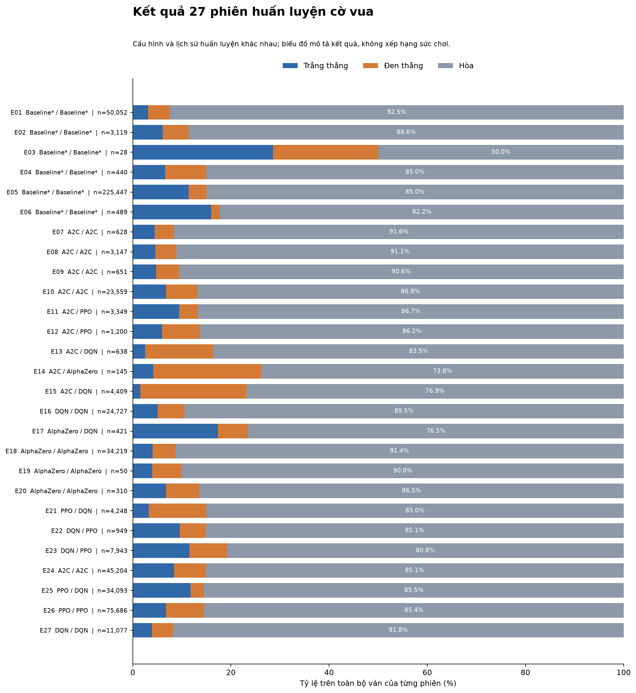
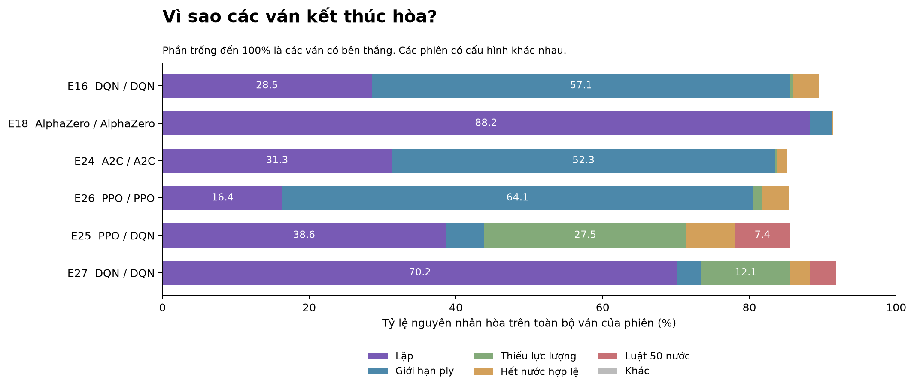

# TỔNG HỢP THỰC NGHIỆM — HỌC TĂNG CƯỜNG CHO CỜ VUA

Ngày tổng hợp: **15/11/2026**. Nguồn: dữ liệu trong repository tại thời điểm tổng hợp; không chạy thêm huấn luyện hoặc đánh giá mô hình.

## 1. Phạm vi và kết luận chính

Đã tổng hợp **27 file `metrics.json` và 15 ảnh `training_log`**, gồm 25 phiên trong `checkpoints/` và 2 phiên trong `src/checkpoints/`. Các phiên bắt đầu từ 08–14/11/2026; snapshot cuối có thời điểm lưu tới 15/11/2026. Tổng số ván ghi nhận trong các phiên là **556.228**, tổng `elapsed_seconds` là **70,25 giờ**. Tổng này cộng các phiên, có huấn luyện nối tiếp và phiên có thể chạy đồng thời; không phải 27 phép thử độc lập, cũng không phải thời gian tính toán thuần.

Các kết quả cho thấy hệ thống đã thu thập được dữ liệu huấn luyện cho A2C, PPO, DQN và AlphaZero cùng nhóm Actor–Critic nền tảng. Hạn chế nổi bật là **tỷ lệ hòa cao**, thường khoảng 80–92% ở các phiên lớn; hai nguyên nhân cần phân biệt là chạm giới hạn lượt và lặp thế cờ. Dữ liệu hiện tại chưa đủ để xếp hạng sức chơi tổng quát hoặc công bố Elo.

Các điểm nên đưa vào phần nhận xét:

- DQN có ưu thế quan sát được trước A2C trong E13/E15 và trước PPO trong E21–E23; PPO lại thắng nhiều hơn DQN trong E25. Điều kiện của các nhóm khác nhau nên chưa có thuật toán thắng tuyệt đối.
- AlphaZero E18 giảm loss nhưng 91,35% ván hòa; 96,59% số ván hòa do lặp. Đây là ví dụ rõ về việc loss giảm chưa bảo đảm sức chơi tăng.
- A2C CPU E24 và PPO CPU E26 có tỷ lệ hòa gần nhau (85,13% và 85,42%). PPO giữ entropy cuối cao hơn; điều này chỉ hỗ trợ nhận xét về đa dạng chính sách trong hai phiên.
- E23 có metadata learning rate không thống nhất; E20 có thành phần “phạt lặp” dương. Cần công bố các điểm này khi sử dụng số liệu.

## 2. Thiết kế hệ thống và cấu hình thực nghiệm

### 2.1. Bài toán và biểu diễn

Hai tác nhân Trắng/Đen chơi và cập nhật mô hình trong quá trình huấn luyện. Nước đi được lọc bằng tập nước hợp lệ. Theo mã nguồn hiện tại, trạng thái là tensor **16 × 8 × 8**: 12 mặt phẳng quân cờ theo góc nhìn tác nhân và 4 mặt phẳng quyền nhập thành. Không gian hành động có **4.096** cặp ô đi–ô đến; phần sinh nước đi chỉ giữ phong cấp Hậu. Vì vậy mô tả thí nghiệm nên ghi rõ giới hạn phong cấp này.

Mạng hiện tại dùng 3 lớp tích chập 64 kênh, lớp fully connected 512, đầu policy/Q và đầu value; phiên mới bổ sung đầu dự đoán nước đối phương và đầu phân loại giai đoạn. Metadata ghi hai quy mô: **4.282.561** tham số/mô hình ở 25 phiên và **6.385.348** ở E25/E27. Không gán kiến trúc hiện tại nguyên vẹn cho toàn bộ phiên lịch sử.

### 2.2. Môi trường chạy được ghi nhận

| Nhóm | Số phiên | Thiết bị / phần mềm được ghi trong JSON |
| --- | --- | --- |
| GPU | 24 | NVIDIA GeForce RTX 3050 Laptop GPU; CUDA; Python 3.10.18; PyTorch 2.5.1+cu121 |
| CPU A2C/PPO | 2 | E24/E26; Python 3.13.5; PyTorch 2.15.0+cpu |
| CPU DQN | 1 | E27; Python 3.12.10; PyTorch 2.15.0+cpu |

Đây là thông tin lấy nguyên từ log, không phải môi trường Python đang dùng để tổng hợp. Chưa có tên CPU, RAM tổng, seed huấn luyện hoặc cấu hình số luồng đầy đủ để tái lập hiệu năng. Toàn bộ phiên ghi `parallel_games=128`, `episodes_per_update=4` và `gamma=0,99`.

### 2.3. Các nhóm siêu tham số chung

| Nhóm | Phiên | LR cấu hình | Shaping | Reward hòa | Max ply | Tham số/mô hình |
| --- | --- | --- | --- | --- | --- | --- |
| Gốc | E01–E21, E24, E26 | 0,0003 | 0,05 | −0,1 | 160 | 4.282.561 |
| Phạt hòa mạnh | E22 | 0,0003 | 0,05 | −5 | 200 | 4.282.561 |
| Kéo dài ván | E23 | 0,003* | 0,05 | −10 | 600 | 4.282.561 |
| Mạng mở rộng | E25, E27 | 0,0003 | 0,01 | 0 | 600 | 6.385.348 |

*E23: `models.White.learning_rate` và `models.Black.learning_rate` đều là **0,0003**. Giá trị 0,003 chỉ nằm trong cấu hình chung. Không viết rằng LR thực tế đã tăng 10 lần. Theo mã hiện tại, optimizer có thể được khôi phục từ checkpoint; đây là một khả năng giải thích, chưa phải nguyên nhân lịch sử đã được xác nhận. `max_plies` là lượt của một bên (ply), nên 160 ply tương đương tối đa khoảng 80 lượt đôi từ bàn khởi đầu chuẩn.

### 2.4. Siêu tham số theo thuật toán

| Thuật toán | Cơ chế được cài đặt | Giá trị có trong metadata |
| --- | --- | --- |
| A2C | Actor–Critic, return chiết khấu, chuẩn hóa advantage, entropy bonus | gamma=0,99; entropy_coef=0,01; episodes_per_update=4 |
| PPO | Clipped surrogate và GAE; nhiều vòng cập nhật theo minibatch | lambda=0,95; clip=0,2; epochs=4; minibatch=256; entropy_coef=0,01 |
| DQN | Double DQN, replay buffer, target network, epsilon-greedy | buffer=20.000; batch=64; warmup=1.000; target_sync=500; train_every=8; epsilon 1→0,05 / 20.000 bước |
| AlphaZero | Policy/value + MCTS và dữ liệu visit count | 25 simulations tự đấu; 50 khi chơi; c_puct=1,5; alpha=0,3; noise_frac=0,25; temp_plies=30; buffer=20.000; batch=128; train_steps=20 |

Siêu tham số AlphaZero ở trên là **giá trị thực nghiệm đã lưu**. File cấu hình hiện tại đã đổi thành 128/256 simulations và buffer 40.000; không dùng các giá trị hiện tại để mô tả các lần chạy cũ. Sáu phiên E01–E06 không có trường `algorithms`/`algorithm_hyperparameters`; gọi là **Baseline Actor–Critic** theo mã lịch sử Git, và giữ dấu * để phân biệt với A2C có nhãn xác nhận.

### 2.5. Reward và dữ liệu khởi tạo

Theo mã hiện tại, thưởng kết thúc gồm thắng +1, thua −1, hòa theo cấu hình, cộng phạt lặp; shaping dùng biến thiên chênh lệch giá trị quân nhân hệ số. Mỗi ván tạo tối đa hai episode của hai màu. AlphaZero hiện tại dùng mục tiêu value từ tổng reward kết thúc đã chặn về [−1,1], còn shaping vẫn được ghi để theo dõi. Đây là giải thích mã hiện tại, không phải xác nhận mọi bản lịch sử có cùng công thức.

E25/E27 có dữ liệu curriculum: khoảng 50% ván khởi tạo nhóm opening, 20% middlegame và 30% endgame. Mã hiện tại khởi tạo opening sau 2–8 ply ngẫu nhiên, middlegame sau 10–24 ply, endgame từ mẫu thế cờ; giới hạn endgame riêng là 100 ply. Hai nhóm khác không xuất trường curriculum nên không suy diễn chúng đã dùng cùng bộ khởi tạo. Hệ số phạt lặp lịch sử không nằm trong `hyperparameters` đã lưu.

## 3. Cách đọc chỉ số

| Chỉ số | Ý nghĩa và phạm vi |
| --- | --- |
| Tỷ lệ toàn phiên | Tự tính từ training.wins / training.games_played; dùng để lập bảng kết quả chính. |
| recent_rates | Cửa sổ tối đa 100 ván cuối; E03 chỉ 28, E19 chỉ 50. Khác mẫu với tỷ lệ toàn phiên. |
| avg_game_length_plies | Trung bình của cửa sổ ván gần nhất; không phải trung bình toàn phiên. |
| game_quality | Trung bình đặc trưng trên tối đa 100 ván gần nhất; repetition_rate là tỷ phần vị trí lặp trong mỗi ván, không phải tỷ lệ ván hòa do lặp. |
| draw_reasons | Số ván hòa tích lũy theo nguyên nhân trong phiên. Chia cho tổng ván và chia cho số ván hòa cho hai tỷ lệ khác nhau. |
| mean_episode_reward | Trung bình tối đa 200 episode gần nhất, gộp hai màu; không tương đương reward riêng bên thắng. |
| optimization | Theo mã hiện tại, trung bình tối đa 50 lần cập nhật mỗi màu. last_loss là lần cập nhật cuối, có thể khác total_loss trung bình. |
| games_per_second / plies_per_second | Chỉ số log lấy cửa sổ khoảng 30 giây. Tốc độ trung bình trong báo cáo được tính riêng bằng games_played / elapsed_seconds. |
| policy_entropy | Độ phân tán hành động; DQN ghi entropy của softmax(Q/T), không hoàn toàn cùng ý nghĩa với policy A2C/PPO. |
| value_explained_variance | Mức giải thích biến thiên target trong batch; ở DQN là Q-target. Giá trị cao chưa đủ kết luận chơi mạnh; giá trị âm cho thấy dự đoán kém theo chỉ số này. |

Loss có thể âm do thành phần actor/entropy. Không so trực tiếp trị tuyệt đối loss A2C, PPO, DQN và AlphaZero vì chúng tối ưu các mục tiêu khác nhau. Số `training_updates` cũng không cùng đơn vị công việc giữa các thuật toán.

## 4. Toàn bộ 27 phiên thực nghiệm

Thứ tự cặp thuật toán luôn là **Trắng / Đen**. Tỷ lệ T/Đ/H trong bảng được tính từ số đếm toàn phiên. Thời gian định dạng giờ:phút:giây. Mã E24/E26 lấy từ `src/checkpoints`; các mã còn lại từ `checkpoints`.

| Mã | Phiên / nguồn JSON | T / Đ | Thời gian | Ván | T thắng / Đ thắng / Hòa | Hòa gần nhất | Thiết bị |
| --- | --- | --- | --- | --- | --- | --- | --- |
| E01 | [20261108_175144](<D:/QUAN TRỌNG/TTNTNC/Viet/ttntnc/ttntnc/checkpoints/exp_20261108_175144/metrics.json>) | Baseline* / Baseline* | 01:16:04 | 50.052 | 3,13% / 4,41% / 92,47% | 92,0% | CUDA |
| E02 | [20261108_222012](<D:/QUAN TRỌNG/TTNTNC/Viet/ttntnc/ttntnc/checkpoints/exp_20261108_222012/metrics.json>) | Baseline* / Baseline* | 00:07:29 | 3.119 | 6,12% / 5,26% / 88,62% | 85,0% | CUDA |
| E03 | [20261109_004149](<D:/QUAN TRỌNG/TTNTNC/Viet/ttntnc/ttntnc/checkpoints/exp_20261109_004149/metrics.json>) | Baseline* / Baseline* | 00:00:17 | 28 | 28,57% / 21,43% / 50,00% | 50,0% | CUDA |
| E04 | [20261109_140833](<D:/QUAN TRỌNG/TTNTNC/Viet/ttntnc/ttntnc/checkpoints/exp_20261109_140833/metrics.json>) | Baseline* / Baseline* | 00:01:11 | 440 | 6,59% / 8,41% / 85,00% | 88,0% | CUDA |
| E05 | [20261109_231239](<D:/QUAN TRỌNG/TTNTNC/Viet/ttntnc/ttntnc/checkpoints/exp_20261109_231239/metrics.json>) | Baseline* / Baseline* | 08:50:44 | 225.447 | 11,41% / 3,58% / 85,02% | 80,0% | CUDA |
| E06 | [20261111_095430](<D:/QUAN TRỌNG/TTNTNC/Viet/ttntnc/ttntnc/checkpoints/exp_20261111_095430/metrics.json>) | Baseline* / Baseline* | 00:01:13 | 489 | 15,95% / 1,84% / 82,21% | 88,0% | CUDA |
| E07 | [20261111_135357](<D:/QUAN TRỌNG/TTNTNC/Viet/ttntnc/ttntnc/checkpoints/exp_20261111_135357/metrics.json>) | A2C / A2C | 00:02:00 | 628 | 4,46% / 3,98% / 91,56% | 95,0% | CUDA |
| E08 | [20261111_140057](<D:/QUAN TRỌNG/TTNTNC/Viet/ttntnc/ttntnc/checkpoints/exp_20261111_140057/metrics.json>) | A2C / A2C | 00:09:34 | 3.147 | 4,58% / 4,35% / 91,07% | 94,0% | CUDA |
| E09 | [20261111_141426](<D:/QUAN TRỌNG/TTNTNC/Viet/ttntnc/ttntnc/checkpoints/exp_20261111_141426/metrics.json>) | A2C / A2C | 00:02:00 | 651 | 4,76% / 4,61% / 90,63% | 97,0% | CUDA |
| E10 | [20261111_143632](<D:/QUAN TRỌNG/TTNTNC/Viet/ttntnc/ttntnc/checkpoints/exp_20261111_143632/metrics.json>) | A2C / A2C | 20:28:16 | 23.559 | 6,78% / 6,35% / 86,88% | 81,0% | CUDA |
| E11 | [20261112_113115](<D:/QUAN TRỌNG/TTNTNC/Viet/ttntnc/ttntnc/checkpoints/exp_20261112_113115/metrics.json>) | A2C / PPO | 00:08:36 | 3.349 | 9,44% / 3,85% / 86,71% | 94,0% | CUDA |
| E12 | [20261112_115622](<D:/QUAN TRỌNG/TTNTNC/Viet/ttntnc/ttntnc/checkpoints/exp_20261112_115622/metrics.json>) | A2C / PPO | 00:03:07 | 1.200 | 6,00% / 7,75% / 86,25% | 77,0% | CUDA |
| E13 | [20261112_121441](<D:/QUAN TRỌNG/TTNTNC/Viet/ttntnc/ttntnc/checkpoints/exp_20261112_121441/metrics.json>) | A2C / DQN | 00:02:35 | 638 | 2,51% / 13,95% / 83,54% | 74,0% | CUDA |
| E14 | [20261112_121856](<D:/QUAN TRỌNG/TTNTNC/Viet/ttntnc/ttntnc/checkpoints/exp_20261112_121856/metrics.json>) | A2C / AlphaZero | 00:02:43 | 145 | 4,14% / 22,07% / 73,79% | 91,0% | CUDA |
| E15 | [20261112_132532](<D:/QUAN TRỌNG/TTNTNC/Viet/ttntnc/ttntnc/checkpoints/exp_20261112_132532/metrics.json>) | A2C / DQN | 00:15:18 | 4.409 | 1,52% / 21,59% / 76,89% | 87,0% | CUDA |
| E16 | [20261112_134110](<D:/QUAN TRỌNG/TTNTNC/Viet/ttntnc/ttntnc/checkpoints/exp_20261112_134110/metrics.json>) | DQN / DQN | 01:51:24 | 24.727 | 5,10% / 5,43% / 89,48% | 91,0% | CUDA |
| E17 | [20261112_153443](<D:/QUAN TRỌNG/TTNTNC/Viet/ttntnc/ttntnc/checkpoints/exp_20261112_153443/metrics.json>) | AlphaZero / DQN | 00:06:29 | 421 | 17,34% / 6,18% / 76,48% | 86,0% | CUDA |
| E18 | [20261112_154125](<D:/QUAN TRỌNG/TTNTNC/Viet/ttntnc/ttntnc/checkpoints/exp_20261112_154125/metrics.json>) | AlphaZero / AlphaZero | 07:24:57 | 34.219 | 4,04% / 4,61% / 91,35% | 93,0% | CUDA |
| E19 | [20261112_232706](<D:/QUAN TRỌNG/TTNTNC/Viet/ttntnc/ttntnc/checkpoints/exp_20261112_232706/metrics.json>) | AlphaZero / AlphaZero | 00:01:19 | 50 | 4,00% / 6,00% / 90,00% | 90,0% | CUDA |
| E20 | [20261112_232956](<D:/QUAN TRỌNG/TTNTNC/Viet/ttntnc/ttntnc/checkpoints/exp_20261112_232956/metrics.json>) | AlphaZero / AlphaZero | 00:04:01 | 310 | 6,77% / 6,77% / 86,45% | 85,0% | CUDA |
| E21 | [20261114_081112](<D:/QUAN TRỌNG/TTNTNC/Viet/ttntnc/ttntnc/checkpoints/exp_20261114_081112/metrics.json>) | PPO / DQN | 00:17:25 | 4.248 | 3,27% / 11,70% / 85,03% | 85,0% | CUDA |
| E22 | [20261114_084332](<D:/QUAN TRỌNG/TTNTNC/Viet/ttntnc/ttntnc/checkpoints/exp_20261114_084332/metrics.json>) | DQN / PPO | 00:04:49 | 949 | 9,59% / 5,27% / 85,14% | 82,0% | CUDA |
| E23 | [20261114_084944](<D:/QUAN TRỌNG/TTNTNC/Viet/ttntnc/ttntnc/checkpoints/exp_20261114_084944/metrics.json>) | DQN / PPO | 00:58:31 | 7.943 | 11,53% / 7,70% / 80,76% | 80,0% | CUDA |
| E24 | [20261114_145819](<D:/QUAN TRỌNG/TTNTNC/Viet/ttntnc/ttntnc/src/checkpoints/exp_20261114_145819/metrics.json>) | A2C / A2C | 03:54:26 | 45.204 | 8,39% / 6,48% / 85,13% | 85,0% | CPU |
| E25 | [20261114_164954](<D:/QUAN TRỌNG/TTNTNC/Viet/ttntnc/ttntnc/checkpoints/exp_20261114_164954/metrics.json>) | PPO / DQN | 04:00:09 | 34.093 | 11,74% / 2,79% / 85,47% | 86,0% | CUDA |
| E26 | [20261114_190522](<D:/QUAN TRỌNG/TTNTNC/Viet/ttntnc/ttntnc/src/checkpoints/exp_20261114_190522/metrics.json>) | PPO / PPO | 14:21:30 | 75.686 | 6,78% / 7,80% / 85,42% | 85,0% | CPU |
| E27 | [20261114_235757](<D:/QUAN TRỌNG/TTNTNC/Viet/ttntnc/ttntnc/checkpoints/exp_20261114_235757/metrics.json>) | DQN / DQN | 05:39:01 | 11.077 | 3,95% / 4,25% / 91,80% | 96,0% | CPU |

Biểu đồ 1. Phân bố kết quả toàn phiên; cấu hình khác nhau nên không dùng biểu đồ này để xếp hạng sức chơi. Bản SVG cùng tên dùng để chèn vào báo cáo mà không giảm chất lượng.

## 5. Phân tích theo nhóm thực nghiệm

### 5.1. Baseline và A2C

Chuỗi baseline E01 → E02 → E03 → E04 → E05 → E06 là huấn luyện nối tiếp, không phải sáu lần khởi tạo độc lập. E05 có nhiều ván nhất nhưng Trắng thắng nhiều hơn Đen và loss/entropy có dấu hiệu mất ổn định. Sáu file cũ chưa ghi nhãn thuật toán, nên chỉ nên dùng làm phần phát triển mô hình nền.

E07–E09 là ba phiên A2C khởi tạo mới, cùng cấu hình và đều bị giới hạn lượt chi phối: lần lượt 572/575, 2.842/2.866 và 586/590 ván hòa do max ply. E10 dài hơn và hòa giảm còn 86,88%, nhưng khác thời lượng và quá trình học nên chưa chứng minh hội tụ.

E24 là phiên A2C CPU đáng đưa vào báo cáo chính: 45.204 ván, 3.792 Trắng thắng, 2.930 Đen thắng và 38.482 hòa. Cuối phiên, entropy rất thấp, explained variance âm và toàn bộ cửa sổ cập nhật bị clipping. Có cơ sở nêu rằng chính sách trở nên tập trung, còn chất lượng critic và khả năng kết thúc ván vẫn hạn chế.

### 5.2. A2C đối đầu PPO, DQN và AlphaZero

E11: A2C Trắng thắng 316, PPO Đen thắng 129; E12 tiếp tục cả hai mô hình nhưng PPO thắng 93, A2C thắng 72. A2C ở E11 đã được huấn luyện trước còn PPO không có checkpoint nạp, do đó ưu thế ở E11 không thể quy hoàn toàn cho thuật toán.

DQN Đen thắng nhiều hơn A2C Trắng trong E13 (89 so với 16) và E15 (952 so với 67). AlphaZero Đen thắng nhiều hơn A2C trong E14 (32 so với 6), nhưng chỉ có 145 ván. Các kết quả này là bằng chứng thăm dò trong khi hai bên vẫn đang học; cần đánh giá mô hình cố định và đổi màu trước khi xếp hạng.

### 5.3. DQN và AlphaZero tự đấu

E16 có 24.727 ván DQN tự đấu và 89,48% hòa. Hai màu bắt đầu từ cùng checkpoint DQN của E15 nên tỷ lệ thắng gần nhau không phải phép đo sức chơi độc lập.

E17: AlphaZero Trắng thắng 73 so với 26 của DQN; chỉ 421 ván. E18 AlphaZero tự đấu 34.219 ván trong khoảng 7,42 giờ, hòa 31.260 ván (91,35%). Có tới 30.193 ván hòa do lặp, bằng 88,23% toàn bộ ván và 96,59% số ván hòa. Độ dài cửa sổ cuối chỉ 58,3 ply; ván ngắn đi chủ yếu đi kèm hòa do lặp, chưa cho thấy kết thúc bằng chiếu hết hiệu quả hơn.

E19/E20 là chuỗi huấn luyện tiếp của E18, tổng mẫu nhỏ; tất cả ván hòa trong từng phiên đều do lặp. E20 có reward lặp dương nên cần kiểm tra trước khi dùng để bàn về hiệu quả reward.

E27 là DQN CPU từ đầu, dùng mạng mở rộng và curriculum: 11.077 ván, hòa 91,80%; 70,19% toàn bộ ván kết thúc hòa do lặp. Explained variance cuối khoảng 0,94 nhưng cửa sổ cuối hòa 96%, cho thấy chỉ số khớp target tốt chưa đủ phản ánh khả năng thắng.

### 5.4. Chuỗi thay đổi PPO–DQN

| Mã | T / Đ | Max ply | Reward hòa | Shaping | Hòa toàn phiên | Hòa do max ply | Ply gần nhất |
| --- | --- | --- | --- | --- | --- | --- | --- |
| E21 | PPO / DQN | 160 | -0,1 | 0,05 | 85,03% | 3.200 | 149,1 |
| E22 | DQN / PPO | 200 | -5,0 | 0,05 | 85,14% | 653 | 171,7 |
| E23 | DQN / PPO | 600 | -10,0 | 0,05 | 80,76% | 4 | 272,5 |
| E25 | PPO / DQN | 600 | 0,0 | 0,01 | 85,47% | 1.792 | 207,5 |

E21 DQN Đen thắng 497 so với 139 của PPO; E22/E23 đổi DQN sang Trắng và vẫn thắng nhiều hơn PPO. Sang E25, PPO Trắng thắng 4.003 so với 950 của DQN Đen.

Tăng giới hạn từ 160 lên 600 đi kèm việc giảm mạnh số ván bị cắt ở E23, nhưng hòa tổng vẫn 80,76%. Đồng thời đã đổi reward, checkpoint, màu và thời lượng, nên đây là chuỗi điều chỉnh hệ thống; chưa phải thí nghiệm loại bỏ từng thành phần có kiểm soát. E25 còn thay quy mô mạng, shaping, reward hòa và phân phối khởi tạo. Không viết rằng một thay đổi riêng lẻ đã gây ra đảo chiều PPO/DQN.

### 5.5. A2C và PPO trên CPU

| Mã | Thuật toán | Ván | Thời gian | Ván/giây TB | Hòa | Entropy T/Đ | Explained variance T/Đ |
| --- | --- | --- | --- | --- | --- | --- | --- |
| E24 | A2C / A2C | 45.204 | 03:54:26 | 3,214 | 85,13% | 0,0274 / 0,1364 | -0,2300 / -0,4966 |
| E26 | PPO / PPO | 75.686 | 14:21:30 | 1,464 | 85,42% | 1,5031 / 1,6845 | 0,0511 / -0,0188 |

Hai phiên cùng cấu hình gốc và cùng số tham số, nhưng khác thời lượng/ngân sách dữ liệu, không phải phép so sánh hiệu năng đã kiểm soát. Tỷ lệ hòa chênh khoảng 0,29 điểm phần trăm, chưa đủ để nói A2C chơi mạnh hơn. PPO giữ entropy cuối cao hơn và biến động gradient trong hình ít cực đoan hơn A2C; cả hai vẫn có hạn chế ở dự đoán value và kết thúc ván. Tốc độ ván/giây là mô tả từng phiên, không phải kết luận CPU tốt hơn GPU hay thuật toán nhanh hơn trong mọi điều kiện.

## 6. Nguyên nhân hòa, curriculum và học chiến lược

### 6.1. Cơ cấu nguyên nhân hòa ở các phiên tiêu biểu

Mỗi ô dưới đây là **số ván (tỷ lệ trên toàn bộ ván của phiên)**, không phải tỷ lệ trong riêng tập ván hòa.

| Mã | Lặp thế | Giới hạn ply | Thiếu lực lượng | Stalemate | 50 nước |
| --- | --- | --- | --- | --- | --- |
| E16 | 7.050 (28,51%) | 14.117 (57,09%) | 78 (0,32%) | 880 (3,56%) | 0 (0,00%) |
| E18 | 30.193 (88,23%) | 1.064 (3,11%) | 0 (0,00%) | 3 (0,01%) | 0 (0,00%) |
| E24 | 14.132 (31,26%) | 23.626 (52,27%) | 84 (0,19%) | 635 (1,40%) | 5 (0,01%) |
| E26 | 12.399 (16,38%) | 48.488 (64,06%) | 956 (1,26%) | 2.805 (3,71%) | 1 (0,00%) |
| E25 | 13.163 (38,61%) | 1.792 (5,26%) | 9.387 (27,53%) | 2.280 (6,69%) | 2.518 (7,39%) |
| E27 | 7.775 (70,19%) | 360 (3,25%) | 1.343 (12,12%) | 295 (2,66%) | 396 (3,57%) |

Biểu đồ 2. Cần phân biệt việc hết ván sớm do lặp với khả năng tạo kết quả thắng/thua. Giới hạn ply lớn hơn làm giảm một nguyên nhân hòa nhưng không tự giải quyết các nguyên nhân khác.

### 6.2. Curriculum chỉ có ở E25/E27

| Mã | Nhóm khởi tạo | Ván | Trắng thắng | Đen thắng | Hòa | Tỷ lệ hòa | Ply TB nhóm |
| --- | --- | --- | --- | --- | --- | --- | --- |
| E25 | opening | 17.058 | 2.803 | 643 | 13.612 | 79,80% | 272,8 |
| E25 | middlegame | 6.718 | 1.105 | 240 | 5.373 | 79,98% | 274,9 |
| E25 | endgame | 10.317 | 95 | 67 | 10.155 | 98,43% | 57,4 |
| E27 | opening | 5.464 | 302 | 318 | 4.844 | 88,65% | 230,6 |
| E27 | middlegame | 2.181 | 113 | 128 | 1.940 | 88,95% | 237,0 |
| E27 | endgame | 3.432 | 22 | 25 | 3.385 | 98,63% | 48,9 |

Tàn cuộc có tỷ lệ hòa 98,43% ở E25 và 98,63% ở E27, cao hơn nhóm opening/middlegame. Điều này cho thấy kết quả nhóm tàn cuộc còn hạn chế. Các mẫu tàn cuộc không phải tất cả đều bảo đảm thắng, nên không diễn giải trực tiếp tỷ lệ thắng thấp thành tỷ lệ chuyển hóa tàn cuộc có lợi. Muốn đo chuyển hóa cần dùng bài kiểm tra KQvK/KRvK riêng.

### 6.3. Đầu dự đoán đối phương và nhận diện giai đoạn

| Mã | Màu | Thuật toán | Dự đoán Top-1 | Top-3 | Nhận diện giai đoạn |
| --- | --- | --- | --- | --- | --- |
| E25 | White | PPO | 17,37% | 39,47% | 93,20% |
| E25 | Black | DQN | 16,73% | 35,41% | 94,92% |
| E27 | White | DQN | 12,62% | 29,42% | 95,73% |
| E27 | Black | DQN | 11,47% | 28,16% | 94,87% |

Các đầu phụ đã có dữ liệu dự đoán; accuracy nhận diện giai đoạn cao hơn accuracy dự đoán nước đối phương. Nhãn giai đoạn trong mã là heuristic từ số nước/lực lượng, nên không gọi accuracy này là độ chính xác chiến thuật hoặc khả năng chơi cờ 95%. Chưa có phép thử tắt/bật đầu phụ hay lookahead để xác định tác động lên sức chơi.

## 7. Nhận xét toàn bộ 15 ảnh huấn luyện

Các nhận xét xu hướng dưới đây dựa trên xem ảnh. Số liệu chính xác lấy từ JSON. Không có `training_log.json` trong bản dữ liệu hiện tại để tính độ dốc, cực trị hoặc thời điểm hội tụ chính xác. Ảnh có thể được xuất trước lần lưu metrics cuối.

| Mã | Ảnh nguồn | Nhận xét để viết báo cáo |
| --- | --- | --- |
| E03 | [training_log.png](<D:/QUAN TRỌNG/TTNTNC/Viet/ttntnc/ttntnc/checkpoints/exp_20261109_004149/training_log.png>) | Biểu đồ dưới 0,3 phút, ít điểm và chỉ 28 ván; chỉ dùng minh họa thử chạy/ghi log. |
| E05 | [training_log.png](<D:/QUAN TRỌNG/TTNTNC/Viet/ttntnc/ttntnc/checkpoints/exp_20261109_231239/training_log.png>) | Hòa chiếm ưu thế; actor loss có các đỉnh rất lớn, entropy Đen thường sát 0. Có đoạn đường nối dài, chưa đủ dữ liệu thô để giải thích khoảng trống. |
| E06 | [training_log.png](<D:/QUAN TRỌNG/TTNTNC/Viet/ttntnc/ttntnc/checkpoints/exp_20261111_095430/training_log.png>) | Phiên khoảng 1,2 phút; actor loss Đen dao động mạnh, entropy thấp. Không diễn giải đường giảm critic loss thành tiến bộ sức chơi. |
| E12 | [training_log.jpg](<D:/QUAN TRỌNG/TTNTNC/Viet/ttntnc/ttntnc/checkpoints/exp_20261112_115622/training_log.jpg>) | PPO Đen có critic loss thấp hơn A2C Trắng trong hình; tỷ lệ hòa giảm ở cuối ảnh. Không so độ lớn hai hàm loss để kết luận thuật toán tốt hơn. |
| E13 | [training_log.jpg](<D:/QUAN TRỌNG/TTNTNC/Viet/ttntnc/ttntnc/checkpoints/exp_20261112_121441/training_log.jpg>) | DQN Đen tăng tỷ lệ thắng trong phần sau ảnh; A2C Trắng gần 0 ở cửa sổ cuối. Actor loss DQN bằng 0 theo cách ghi chỉ số. |
| E18 | [training_log.jpg](<D:/QUAN TRỌNG/TTNTNC/Viet/ttntnc/ttntnc/checkpoints/exp_20261112_154125/training_log.jpg>) | Loss AlphaZero giảm dần trong khi hòa vẫn rất cao; cơ cấu hòa do lặp tăng, độ dài ván giảm. Đây là hình rõ nhất để bàn về mục tiêu tối ưu và hành vi thực tế. |
| E19 | [training_log.jpg](<D:/QUAN TRỌNG/TTNTNC/Viet/ttntnc/ttntnc/checkpoints/exp_20261112_232706/training_log.jpg>) | Mẫu rất nhỏ; hòa do lặp tăng nhanh, reward giảm sâu theo thành phần phạt lặp. |
| E20 | [training_log.jpg](<D:/QUAN TRỌNG/TTNTNC/Viet/ttntnc/ttntnc/checkpoints/exp_20261112_232956/training_log.jpg>) | Đường thành phần lặp mang dấu dương, cùng reward dương, trong khi hòa do lặp vẫn áp đảo. Hình củng cố việc cần kiểm tra reward lịch sử. |
| E21 | [training_log.jpg](<D:/QUAN TRỌNG/TTNTNC/Viet/ttntnc/ttntnc/checkpoints/exp_20261114_081112/training_log.jpg>) | DQN Đen thường có tỷ lệ thắng lớn hơn PPO Trắng; hòa chủ yếu do giới hạn lượt. PPO có một số điểm explained variance âm sâu. |
| E22 | [training_log.jpg](<D:/QUAN TRỌNG/TTNTNC/Viet/ttntnc/ttntnc/checkpoints/exp_20261114_084332/training_log.jpg>) | Reward bị chi phối bởi phạt hòa và lặp; ảnh chỉ bao phủ khoảng 2 phút trong khi metrics ghi 4,82 phút. Không xem mép phải ảnh là snapshot cuối JSON. |
| E23 | [training_log.jpg](<D:/QUAN TRỌNG/TTNTNC/Viet/ttntnc/ttntnc/checkpoints/exp_20261114_084944/training_log.jpg>) | Reward âm lớn, ván dài hơn, hòa do giới hạn lượt gần biến mất nhưng các nguyên nhân hòa khác còn cao. Ảnh khoảng 50 phút, metrics ghi 58,52 phút; hai artifact có thể khác thời điểm lưu. |
| E24 | [training_log.jpg](<D:/QUAN TRỌNG/TTNTNC/Viet/ttntnc/ttntnc/src/checkpoints/exp_20261114_145819/training_log.jpg>) | Entropy giảm về rất thấp ở cuối, gradient norm tăng mạnh và explained variance âm; loss không ổn định hoàn toàn. Hòa vẫn chiếm phần lớn. |
| E25 | [training_log.jpg](<D:/QUAN TRỌNG/TTNTNC/Viet/ttntnc/ttntnc/checkpoints/exp_20261114_164954/training_log.jpg>) | PPO Trắng thắng nhiều hơn DQN Đen; loss giảm sau đầu phiên nhưng hòa vẫn cao. Entropy tăng dần trong phiên này, khác nhóm PPO tự đấu CPU. |
| E26 | [training_log.jpg](<D:/QUAN TRỌNG/TTNTNC/Viet/ttntnc/ttntnc/src/checkpoints/exp_20261114_190522/training_log.jpg>) | Entropy giảm từ khoảng 3,4 rồi duy trì trên 1 ở phần sau; hòa vẫn quanh mức cao. Có đỉnh explained variance âm rất sâu, không nên chỉ báo cáo giá trị cuối. |
| E27 | [training_log.jpg](<D:/QUAN TRỌNG/TTNTNC/Viet/ttntnc/ttntnc/checkpoints/exp_20261114_235757/training_log.jpg>) | Hòa thường trên 90%; loss DQN tăng trong giai đoạn đầu rồi dao động. Cột CPU/GPU trống vì thiếu dữ liệu, không phải mức sử dụng bằng 0%. |

## 8. Các giới hạn và điểm dữ liệu cần công bố

1. **Đây là log huấn luyện.** Hai bên vẫn cập nhật mô hình, chưa phải giải đấu đánh giá checkpoint cố định. Tỷ lệ thắng trong huấn luyện không phải win rate trước đối thủ chuẩn.
2. **Lịch sử nạp mô hình khác nhau.** Có từ đầu, nạp một bên, nạp cả hai bên và đổi màu. Không gộp toàn bộ ván để tạo bảng xếp hạng thuật toán.
3. **Không đồng nhất cấu hình.** Khác reward hòa, shaping, max ply, quy mô mạng, thiết bị, thời gian và curriculum.
4. **Thiếu kiểm soát ngẫu nhiên.** Không lưu seed huấn luyện hoặc thiết kế đánh giá lặp nhiều seed có kiểm soát. E07–E09 cùng cấu hình nhưng đều ngắn và không ghi seed; chưa có khoảng tin cậy cho đánh giá độc lập.
5. **Thiếu file mô hình và log thời gian thô.** Các file `.pt` được nhắc trong metadata nhưng không có trong hai thư mục thực nghiệm; `training_log.json` cũng vắng mặt. `.gitignore` có `*.pt` và `training_log.json`. Chưa thể nạp lại model để kiểm thử hoặc tái tính đường cong từ repository này.
6. **E23 không nhất quán LR.** Cấu hình 0,003; optimizer trong thông tin cả hai mô hình 0,0003.
7. **E20 có “phạt” mang dấu dương.** `repetition_penalty_mean=+1,66`, `mean_episode_reward=+1,58`, trong khi tất cả 268 ván hòa do lặp. Đây là điểm cần kiểm tra reward lịch sử, chưa xác định là chủ ý hay lỗi.
8. **Hệ số phạt lặp chưa được lưu trong hyperparameters.** Không thể khẳng định các phiên đã dùng cùng hệ số chỉ từ bảng cấu hình.
9. **Không suy diễn từ threefold=0.** Các snapshot chi tiết đều ghi `threefold_repetition_rate=0` dù có hòa do lặp. Theo mã hiện tại, `claim_draw=True` có thể nhận hòa khi một nước hợp lệ tiếp theo sẽ tạo lần lặp thứ ba; bộ đặc trưng chỉ đếm vị trí thực sự đã xuất hiện trong move stack. Hai chỉ số không nhất thiết mâu thuẫn, nhưng cần ghi rõ định nghĩa.
10. **Thiếu số liệu là thiếu số liệu.** CPU/GPU utilization hoặc memory `null` không phải 0. Process CPU có thể vượt 100% theo cách cộng nhiều lõi.
11. **Ảnh không luôn trùng snapshot cuối.** E22/E23 có phạm vi thời gian ảnh ngắn hơn `elapsed_seconds` của JSON.
12. **Có mã kiểm tra kỹ năng nhưng chưa có kết quả được lưu.** `skill_eval.py` có chiếu hết một nước, tránh chiếu hết, ăn quân miễn phí và chuyển hóa KQvK/KRvK. Không tìm thấy artifact kết quả để báo cáo tỷ lệ thành công hay Elo.

## 9. Đoạn văn có thể dùng trong báo cáo

### 9.1. Mô tả tổ chức thực nghiệm

> Hệ thống cờ vua học tăng cường được thực nghiệm với các thuật toán A2C, PPO, DQN và AlphaZero, bên cạnh mô hình Actor–Critic nền tảng. Dữ liệu thu thập gồm 27 phiên huấn luyện, ghi nhận tổng cộng 556.228 ván. Các phiên sử dụng 128 môi trường bàn cờ đồng thời và hệ số chiết khấu 0,99. Phần lớn phiên được chạy trên GPU NVIDIA GeForce RTX 3050 Laptop GPU; ba phiên chạy trên CPU. Các cấu hình được thay đổi theo giai đoạn phát triển, gồm giới hạn lượt, cơ chế reward và quy mô mạng. Vì vậy, kết quả được phân tích theo từng nhóm cấu hình và lịch sử khởi tạo thay vì xem toàn bộ phiên là các phép so sánh độc lập.

### 9.2. Nhận xét kết quả

> Các phiên huấn luyện lớn vẫn có tỷ lệ hòa cao. Ở phiên A2C CPU, hệ thống ghi nhận 45.204 ván với tỷ lệ hòa 85,13%; phiên PPO CPU ghi nhận 75.686 ván với tỷ lệ hòa 85,42%. PPO duy trì entropy cuối cao hơn trong hai phiên này, trong khi A2C có entropy thấp và explained variance âm ở snapshot cuối. AlphaZero tự đấu 34.219 ván đạt tỷ lệ hòa 91,35%, trong đó hòa do lặp chiếm 96,59% số ván hòa. Kết quả cho thấy việc giảm loss hoặc kéo dài huấn luyện chưa bảo đảm tác nhân học được cách kết thúc ván hiệu quả.

### 9.3. So sánh thuật toán

> DQN có số ván thắng cao hơn A2C và PPO trong một số cấu hình ban đầu; tuy nhiên, PPO lại thắng nhiều hơn DQN ở phiên sử dụng mạng mở rộng và dữ liệu curriculum. Do các phiên khác nhau về checkpoint khởi tạo, màu quân, reward và thời lượng huấn luyện, kết quả này chỉ phản ánh ưu thế trong từng cấu hình cụ thể. Chưa đủ cơ sở xác lập thứ hạng sức chơi tổng quát giữa bốn thuật toán.

### 9.4. Hạn chế và hướng phát triển

> Hạn chế chính của hệ thống là hòa do lặp và hòa do giới hạn lượt còn phổ biến, đồng thời một số chỉ số tối ưu hóa chưa ổn định. Các bước đánh giá tiếp theo cần cố định checkpoint, đổi màu đối xứng, sử dụng cùng bộ vị trí khởi đầu và ngân sách tính toán, đồng thời lặp lại với nhiều seed. Cần bổ sung đối thủ chuẩn và bài kiểm tra kỹ năng để phân biệt khả năng khớp mục tiêu huấn luyện với năng lực chơi cờ thực tế. Dữ liệu cũng cần lưu đầy đủ hệ số reward, trạng thái optimizer và log thời gian nhằm tăng khả năng tái lập.

## 10. Dàn ý đề xuất cho phần thực nghiệm

1. Mục tiêu: kiểm tra khả năng học tự đấu, độ ổn định cập nhật và hiện tượng hòa/lặp.
2. Môi trường và thiết lập: encoding, mạng, reward, phần cứng, 128 bàn đồng thời.
3. Nhóm thử nghiệm: baseline → A2C → đối đầu thuật toán → AlphaZero → điều chỉnh PPO/DQN → curriculum/đầu phụ.
4. Kết quả định lượng: bảng 27 phiên, chọn E16/E18/E24/E25/E26/E27 để phân tích sâu.
5. Biểu đồ: dùng hai hình tổng hợp cùng ảnh E18, E24, E26; ảnh E20 để minh họa điểm reward cần kiểm tra.
6. Thảo luận: hòa do giới hạn và lặp, entropy, value, tác động của điều kiện khởi tạo.
7. Hạn chế và thực nghiệm tiếp theo: mô hình cố định, đổi màu, nhiều seed, kiểm tra kỹ năng và đối thủ chuẩn.

Phần thực nghiệm tiếp theo được đề xuất ở đây **chưa được thực hiện**. Không ghi các đề xuất thành kết quả đã có.

## Phụ lục A. Hồ sơ chi tiết từng phiên

### E01 — exp_20261108_175144

- Nguồn: [metrics.json](<D:/QUAN TRỌNG/TTNTNC/Viet/ttntnc/ttntnc/checkpoints/exp_20261108_175144/metrics.json>); cặp **Baseline* / Baseline***; thiết bị **CUDA**.

- Bắt đầu `2026-11-08T17:51:44`, lưu `2026-11-08T19:07:48`; thời gian 01:16:04; số lần lưu 38. Timestamp được giữ nguyên từ log, không có múi giờ trong chuỗi.

- Số ván: 50.052; Trắng thắng / Đen thắng / hòa: **1.565 / 2.206 / 46.281**.

- Cửa sổ cuối 100 ván, T/Đ/H: 3,0% / 5,0% / 92,0%; độ dài trung bình cửa sổ 118,7 ply.

- Cấu hình: LR chung 0.0003; LR mô hình T/Đ 0.0003/0.0003; gamma 0.99; shaping 0.05; hòa -0.1; max ply 160. Tốc độ trung bình theo đồng hồ 10,966 ván/giây.

- Khởi tạo: không có checkpoint nạp trong `resumed_from` (ghi là từ đầu theo metadata).

- Loss lần cuối T/Đ: 0,1229 / -0,5202.

- Chỉ số chi tiết: file chưa có nhóm `metrics`.

- Nhận xét: Phiên nền tảng dài đầu tiên; hòa chiếm 92,47%. Chưa có nhóm metrics chi tiết nên không xác định được cơ cấu nguyên nhân hòa từ file này.

- Ảnh: không có ảnh huấn luyện trong thư mục phiên.

### E02 — exp_20261108_222012

- Nguồn: [metrics.json](<D:/QUAN TRỌNG/TTNTNC/Viet/ttntnc/ttntnc/checkpoints/exp_20261108_222012/metrics.json>); cặp **Baseline* / Baseline***; thiết bị **CUDA**.

- Bắt đầu `2026-11-08T22:20:12`, lưu `2026-11-08T22:27:41`; thời gian 00:07:29; số lần lưu 5. Timestamp được giữ nguyên từ log, không có múi giờ trong chuỗi.

- Số ván: 3.119; Trắng thắng / Đen thắng / hòa: **191 / 164 / 2.764**.

- Cửa sổ cuối 100 ván, T/Đ/H: 7,0% / 8,0% / 85,0%; độ dài trung bình cửa sổ 123,5 ply.

- Cấu hình: LR chung 0.0003; LR mô hình T/Đ 0.0003/0.0003; gamma 0.99; shaping 0.05; hòa -0.1; max ply 160. Tốc độ trung bình theo đồng hồ 6,951 ván/giây.

- Huấn luyện tiếp từ `exp_20261108_175144`.

- Loss lần cuối T/Đ: -0,1292 / -0,0950.

- Chất lượng cửa sổ: vị trí lặp 1,58%; đảo nước 10,36%; trì trệ 67,88%; tỷ lệ vị trí duy nhất 98,42%. Reward episode trung bình -0,2038.

- Nguyên nhân hòa (số ván): lặp 786; 50 nước 0; stalemate 37; thiếu lực lượng 6; max ply 1.935; khác 0.

- Nhận xét: Huấn luyện tiếp từ E01; hòa còn 88,62% trong phiên mới. Đây là mô tả hai phiên nối tiếp, chưa chứng minh tác động của một thay đổi riêng lẻ.

- Ảnh: không có ảnh huấn luyện trong thư mục phiên.

### E03 — exp_20261109_004149

- Nguồn: [metrics.json](<D:/QUAN TRỌNG/TTNTNC/Viet/ttntnc/ttntnc/checkpoints/exp_20261109_004149/metrics.json>); cặp **Baseline* / Baseline***; thiết bị **CUDA**.

- Bắt đầu `2026-11-09T00:41:49`, lưu `2026-11-09T00:42:05`; thời gian 00:00:17; số lần lưu 1. Timestamp được giữ nguyên từ log, không có múi giờ trong chuỗi.

- Số ván: 28; Trắng thắng / Đen thắng / hòa: **8 / 6 / 14**.

- Cửa sổ cuối 28 ván, T/Đ/H: 28,6% / 21,4% / 50,0%; độ dài trung bình cửa sổ 55,0 ply.

- Cấu hình: LR chung 0.0003; LR mô hình T/Đ 0.0003/0.0003; gamma 0.99; shaping 0.05; hòa -0.1; max ply 160. Tốc độ trung bình theo đồng hồ 1,677 ván/giây.

- Huấn luyện tiếp từ `exp_20261108_222012`.

- Loss lần cuối T/Đ: 0,6922 / -0,1560.

- Chất lượng cửa sổ: vị trí lặp 2,14%; đảo nước 8,68%; trì trệ 54,93%; tỷ lệ vị trí duy nhất 97,86%. Reward episode trung bình -0,1348.

- Nguyên nhân hòa (số ván): lặp 13; 50 nước 0; stalemate 1; thiếu lực lượng 0; max ply 0; khác 0.

- Nhận xét: Chỉ 28 ván trong 16,7 giây; mức hòa 50% không đủ đại diện để chọn mô hình tốt nhất. Các bàn ngắn kết thúc trước cũng có thể ảnh hưởng mẫu đầu phiên.

- Ảnh: [training_log.png](<D:/QUAN TRỌNG/TTNTNC/Viet/ttntnc/ttntnc/checkpoints/exp_20261109_004149/training_log.png>).

### E04 — exp_20261109_140833

- Nguồn: [metrics.json](<D:/QUAN TRỌNG/TTNTNC/Viet/ttntnc/ttntnc/checkpoints/exp_20261109_140833/metrics.json>); cặp **Baseline* / Baseline***; thiết bị **CUDA**.

- Bắt đầu `2026-11-09T14:08:33`, lưu `2026-11-09T14:09:45`; thời gian 00:01:11; số lần lưu 1. Timestamp được giữ nguyên từ log, không có múi giờ trong chuỗi.

- Số ván: 440; Trắng thắng / Đen thắng / hòa: **29 / 37 / 374**.

- Cửa sổ cuối 100 ván, T/Đ/H: 7,0% / 5,0% / 88,0%; độ dài trung bình cửa sổ 144,0 ply.

- Cấu hình: LR chung 0.0003; LR mô hình T/Đ 0.0003/0.0003; gamma 0.99; shaping 0.05; hòa -0.1; max ply 160. Tốc độ trung bình theo đồng hồ 6,171 ván/giây.

- Huấn luyện tiếp từ `exp_20261109_004149`.

- Loss lần cuối T/Đ: 0,1353 / 0,4370.

- Chất lượng cửa sổ: vị trí lặp 0,76%; đảo nước 6,65%; trì trệ 70,53%; tỷ lệ vị trí duy nhất 99,24%. Reward episode trung bình -0,1457.

- Nguyên nhân hòa (số ván): lặp 93; 50 nước 0; stalemate 5; thiếu lực lượng 0; max ply 276; khác 0.

- Nhận xét: Phiên nối tiếp ngắn, 440 ván; hòa 85,00%, phần lớn ván hòa do giới hạn lượt hoặc lặp.

- Ảnh: không có ảnh huấn luyện trong thư mục phiên.

### E05 — exp_20261109_231239

- Nguồn: [metrics.json](<D:/QUAN TRỌNG/TTNTNC/Viet/ttntnc/ttntnc/checkpoints/exp_20261109_231239/metrics.json>); cặp **Baseline* / Baseline***; thiết bị **CUDA**.

- Bắt đầu `2026-11-09T23:12:39`, lưu `2026-11-10T08:03:23`; thời gian 08:50:44; số lần lưu 228. Timestamp được giữ nguyên từ log, không có múi giờ trong chuỗi.

- Số ván: 225.447; Trắng thắng / Đen thắng / hòa: **25.718 / 8.060 / 191.669**.

- Cửa sổ cuối 100 ván, T/Đ/H: 13,0% / 7,0% / 80,0%; độ dài trung bình cửa sổ 114,3 ply.

- Cấu hình: LR chung 0.0003; LR mô hình T/Đ 0.0003/0.0003; gamma 0.99; shaping 0.05; hòa -0.1; max ply 160. Tốc độ trung bình theo đồng hồ 7,080 ván/giây.

- Huấn luyện tiếp từ `exp_20261109_140833`.

- Loss lần cuối T/Đ: 0,1545 / 1,5273.

- Chất lượng cửa sổ: vị trí lặp 3,53%; đảo nước 21,86%; trì trệ 68,75%; tỷ lệ vị trí duy nhất 96,47%. Reward episode trung bình -0,3572.

- Nguyên nhân hòa (số ván): lặp 122.140; 50 nước 21; stalemate 2.501; thiếu lực lượng 219; max ply 66.788; khác 0.

- Nhận xét: Phiên nhiều ván nhất: 225.447 ván. Trắng thắng 25.718, Đen thắng 8.060; hòa vẫn 85,02%. Biểu đồ loss có đỉnh rất lớn, entropy Đen thường gần 0: dấu hiệu cần xem xét về độ ổn định và độ đa dạng hành động.

- Ảnh: [training_log.png](<D:/QUAN TRỌNG/TTNTNC/Viet/ttntnc/ttntnc/checkpoints/exp_20261109_231239/training_log.png>).

### E06 — exp_20261111_095430

- Nguồn: [metrics.json](<D:/QUAN TRỌNG/TTNTNC/Viet/ttntnc/ttntnc/checkpoints/exp_20261111_095430/metrics.json>); cặp **Baseline* / Baseline***; thiết bị **CUDA**.

- Bắt đầu `2026-11-11T09:54:30`, lưu `2026-11-11T09:55:43`; thời gian 00:01:13; số lần lưu 1. Timestamp được giữ nguyên từ log, không có múi giờ trong chuỗi.

- Số ván: 489; Trắng thắng / Đen thắng / hòa: **78 / 9 / 402**.

- Cửa sổ cuối 100 ván, T/Đ/H: 10,0% / 2,0% / 88,0%; độ dài trung bình cửa sổ 112,1 ply.

- Cấu hình: LR chung 0.0003; LR mô hình T/Đ 0.0003/0.0003; gamma 0.99; shaping 0.05; hòa -0.1; max ply 160. Tốc độ trung bình theo đồng hồ 6,671 ván/giây.

- Huấn luyện tiếp từ `exp_20261109_231239`.

- Loss lần cuối T/Đ: 0,0680 / 1,0166.

- Chất lượng cửa sổ: vị trí lặp 3,67%; đảo nước 22,37%; trì trệ 69,15%; tỷ lệ vị trí duy nhất 96,33%. Reward episode trung bình -0,3495.

- Nguyên nhân hòa (số ván): lặp 311; 50 nước 0; stalemate 9; thiếu lực lượng 0; max ply 82; khác 0.

- Nhận xét: Tiếp tục E05 trong thời gian ngắn; Trắng thắng nhiều hơn Đen, nhưng hòa 82,21%. Biểu đồ actor loss Đen dao động lớn và entropy hai bên thấp.

- Ảnh: [training_log.png](<D:/QUAN TRỌNG/TTNTNC/Viet/ttntnc/ttntnc/checkpoints/exp_20261111_095430/training_log.png>).

### E07 — exp_20261111_135357

- Nguồn: [metrics.json](<D:/QUAN TRỌNG/TTNTNC/Viet/ttntnc/ttntnc/checkpoints/exp_20261111_135357/metrics.json>); cặp **A2C / A2C**; thiết bị **CUDA**.

- Bắt đầu `2026-11-11T13:53:57`, lưu `2026-11-11T13:55:57`; thời gian 00:02:00; số lần lưu 1. Timestamp được giữ nguyên từ log, không có múi giờ trong chuỗi.

- Số ván: 628; Trắng thắng / Đen thắng / hòa: **28 / 25 / 575**.

- Cửa sổ cuối 100 ván, T/Đ/H: 1,0% / 4,0% / 95,0%; độ dài trung bình cửa sổ 158,2 ply.

- Cấu hình: LR chung 0.0003; LR mô hình T/Đ 0.0003/0.0003; gamma 0.99; shaping 0.05; hòa -0.1; max ply 160. Tốc độ trung bình theo đồng hồ 5,220 ván/giây.

- Khởi tạo: không có checkpoint nạp trong `resumed_from` (ghi là từ đầu theo metadata).

- Loss lần cuối T/Đ: -0,1500 / -0,2147.

- Chất lượng cửa sổ: vị trí lặp 0,07%; đảo nước 2,64%; trì trệ 71,65%; tỷ lệ vị trí duy nhất 99,93%. Reward episode trung bình -0,1020.

- Nguyên nhân hòa (số ván): lặp 2; 50 nước 0; stalemate 1; thiếu lực lượng 0; max ply 572; khác 0.

- Nhận xét: A2C từ đầu, chạy ngắn; 572/575 ván hòa là do chạm giới hạn lượt. Chưa thể đánh giá khả năng kết thúc ván.

- Ảnh: không có ảnh huấn luyện trong thư mục phiên.

### E08 — exp_20261111_140057

- Nguồn: [metrics.json](<D:/QUAN TRỌNG/TTNTNC/Viet/ttntnc/ttntnc/checkpoints/exp_20261111_140057/metrics.json>); cặp **A2C / A2C**; thiết bị **CUDA**.

- Bắt đầu `2026-11-11T14:00:57`, lưu `2026-11-11T14:10:31`; thời gian 00:09:34; số lần lưu 5. Timestamp được giữ nguyên từ log, không có múi giờ trong chuỗi.

- Số ván: 3.147; Trắng thắng / Đen thắng / hòa: **144 / 137 / 2.866**.

- Cửa sổ cuối 100 ván, T/Đ/H: 5,0% / 1,0% / 94,0%; độ dài trung bình cửa sổ 158,0 ply.

- Cấu hình: LR chung 0.0003; LR mô hình T/Đ 0.0003/0.0003; gamma 0.99; shaping 0.05; hòa -0.1; max ply 160. Tốc độ trung bình theo đồng hồ 5,478 ván/giây.

- Khởi tạo: không có checkpoint nạp trong `resumed_from` (ghi là từ đầu theo metadata).

- Loss lần cuối T/Đ: 0,1208 / 0,1607.

- Chất lượng cửa sổ: vị trí lặp 0,10%; đảo nước 2,95%; trì trệ 70,67%; tỷ lệ vị trí duy nhất 99,90%. Reward episode trung bình -0,1050.

- Nguyên nhân hòa (số ván): lặp 12; 50 nước 0; stalemate 12; thiếu lực lượng 0; max ply 2.842; khác 0.

- Nhận xét: A2C từ đầu; 2.842/2.866 ván hòa do chạm giới hạn lượt. Độ dài gần 160 ply ở cửa sổ cuối cho thấy nhiều ván bị cắt.

- Ảnh: không có ảnh huấn luyện trong thư mục phiên.

### E09 — exp_20261111_141426

- Nguồn: [metrics.json](<D:/QUAN TRỌNG/TTNTNC/Viet/ttntnc/ttntnc/checkpoints/exp_20261111_141426/metrics.json>); cặp **A2C / A2C**; thiết bị **CUDA**.

- Bắt đầu `2026-11-11T14:14:26`, lưu `2026-11-11T14:16:26`; thời gian 00:02:00; số lần lưu 1. Timestamp được giữ nguyên từ log, không có múi giờ trong chuỗi.

- Số ván: 651; Trắng thắng / Đen thắng / hòa: **31 / 30 / 590**.

- Cửa sổ cuối 100 ván, T/Đ/H: 1,0% / 2,0% / 97,0%; độ dài trung bình cửa sổ 158,4 ply.

- Cấu hình: LR chung 0.0003; LR mô hình T/Đ 0.0003/0.0003; gamma 0.99; shaping 0.05; hòa -0.1; max ply 160. Tốc độ trung bình theo đồng hồ 5,411 ván/giây.

- Khởi tạo: không có checkpoint nạp trong `resumed_from` (ghi là từ đầu theo metadata).

- Loss lần cuối T/Đ: -0,0677 / -0,0728.

- Chất lượng cửa sổ: vị trí lặp 0,02%; đảo nước 2,79%; trì trệ 70,74%; tỷ lệ vị trí duy nhất 99,98%. Reward episode trung bình -0,0987.

- Nguyên nhân hòa (số ván): lặp 3; 50 nước 0; stalemate 0; thiếu lực lượng 1; max ply 586; khác 0.

- Nhận xét: A2C từ đầu, 651 ván; 586/590 ván hòa do giới hạn lượt, hòa ở cửa sổ cuối lên 97%.

- Ảnh: không có ảnh huấn luyện trong thư mục phiên.

### E10 — exp_20261111_143632

- Nguồn: [metrics.json](<D:/QUAN TRỌNG/TTNTNC/Viet/ttntnc/ttntnc/checkpoints/exp_20261111_143632/metrics.json>); cặp **A2C / A2C**; thiết bị **CUDA**.

- Bắt đầu `2026-11-11T14:36:32`, lưu `2026-11-12T11:04:47`; thời gian 20:28:16; số lần lưu 29. Timestamp được giữ nguyên từ log, không có múi giờ trong chuỗi.

- Số ván: 23.559; Trắng thắng / Đen thắng / hòa: **1.597 / 1.495 / 20.467**.

- Cửa sổ cuối 100 ván, T/Đ/H: 9,0% / 10,0% / 81,0%; độ dài trung bình cửa sổ 111,8 ply.

- Cấu hình: LR chung 0.0003; LR mô hình T/Đ 0.0003/0.0003; gamma 0.99; shaping 0.05; hòa -0.1; max ply 160. Tốc độ trung bình theo đồng hồ 0,320 ván/giây.

- Khởi tạo: không có checkpoint nạp trong `resumed_from` (ghi là từ đầu theo metadata).

- Loss lần cuối T/Đ: 1,1497 / 0,2322.

- Chất lượng cửa sổ: vị trí lặp 2,57%; đảo nước 8,54%; trì trệ 66,44%; tỷ lệ vị trí duy nhất 97,43%. Reward episode trung bình -0,2045.

- Nguyên nhân hòa (số ván): lặp 5.644; 50 nước 0; stalemate 264; thiếu lực lượng 17; max ply 14.542; khác 0.

- Nhận xét: A2C chạy dài theo đồng hồ: 20 giờ 28 phút, 23.559 ván, hòa 86,88%. Không coi thời gian này là thời gian tính toán GPU thuần; file không tách thời gian tạm dừng.

- Ảnh: không có ảnh huấn luyện trong thư mục phiên.

### E11 — exp_20261112_113115

- Nguồn: [metrics.json](<D:/QUAN TRỌNG/TTNTNC/Viet/ttntnc/ttntnc/checkpoints/exp_20261112_113115/metrics.json>); cặp **A2C / PPO**; thiết bị **CUDA**.

- Bắt đầu `2026-11-12T11:31:15`, lưu `2026-11-12T11:39:51`; thời gian 00:08:36; số lần lưu 6. Timestamp được giữ nguyên từ log, không có múi giờ trong chuỗi.

- Số ván: 3.349; Trắng thắng / Đen thắng / hòa: **316 / 129 / 2.904**.

- Cửa sổ cuối 100 ván, T/Đ/H: 3,0% / 3,0% / 94,0%; độ dài trung bình cửa sổ 137,2 ply.

- Cấu hình: LR chung 0.0003; LR mô hình T/Đ 0.0003/0.0003; gamma 0.99; shaping 0.05; hòa -0.1; max ply 160. Tốc độ trung bình theo đồng hồ 6,492 ván/giây.

- Checkpoint nạp: White: `exp_20261111_143632/white_a2c.pt`. Các đường dẫn máy gốc không bảo đảm tồn tại trong repository.

- Loss lần cuối T/Đ: 0,3814 / 0,0511.

- Chất lượng cửa sổ: vị trí lặp 1,47%; đảo nước 11,47%; trì trệ 70,50%; tỷ lệ vị trí duy nhất 98,53%. Reward episode trung bình -0,2105.

- Nguyên nhân hòa (số ván): lặp 880; 50 nước 0; stalemate 30; thiếu lực lượng 0; max ply 1.994; khác 0.

- Nhận xét: A2C Trắng nạp từ E10, PPO Đen không có đường dẫn nạp. Trắng thắng 316 so với 129: so sánh chịu ảnh hưởng lịch sử huấn luyện không cân bằng.

- Ảnh: không có ảnh huấn luyện trong thư mục phiên.

### E12 — exp_20261112_115622

- Nguồn: [metrics.json](<D:/QUAN TRỌNG/TTNTNC/Viet/ttntnc/ttntnc/checkpoints/exp_20261112_115622/metrics.json>); cặp **A2C / PPO**; thiết bị **CUDA**.

- Bắt đầu `2026-11-12T11:56:22`, lưu `2026-11-12T11:59:29`; thời gian 00:03:07; số lần lưu 2. Timestamp được giữ nguyên từ log, không có múi giờ trong chuỗi.

- Số ván: 1.200; Trắng thắng / Đen thắng / hòa: **72 / 93 / 1.035**.

- Cửa sổ cuối 100 ván, T/Đ/H: 9,0% / 14,0% / 77,0%; độ dài trung bình cửa sổ 136,0 ply.

- Cấu hình: LR chung 0.0003; LR mô hình T/Đ 0.0003/0.0003; gamma 0.99; shaping 0.05; hòa -0.1; max ply 160. Tốc độ trung bình theo đồng hồ 6,417 ván/giây.

- Checkpoint nạp: White: `exp_20261112_113115/white_a2c.pt`; Black: `exp_20261112_113115/black_ppo.pt`. Các đường dẫn máy gốc không bảo đảm tồn tại trong repository.

- Loss lần cuối T/Đ: -0,4731 / -0,0178.

- Chất lượng cửa sổ: vị trí lặp 0,72%; đảo nước 6,84%; trì trệ 68,23%; tỷ lệ vị trí duy nhất 99,28%. Reward episode trung bình -0,1205.

- Nguyên nhân hòa (số ván): lặp 322; 50 nước 0; stalemate 7; thiếu lực lượng 0; max ply 706; khác 0.

- Nhận xét: Cả hai tiếp tục E11; PPO Đen thắng 93 so với 72 của A2C. Kết quả đảo chiều so với phiên trước nên chưa có thứ hạng A2C/PPO ổn định.

- Ảnh: [training_log.jpg](<D:/QUAN TRỌNG/TTNTNC/Viet/ttntnc/ttntnc/checkpoints/exp_20261112_115622/training_log.jpg>).

### E13 — exp_20261112_121441

- Nguồn: [metrics.json](<D:/QUAN TRỌNG/TTNTNC/Viet/ttntnc/ttntnc/checkpoints/exp_20261112_121441/metrics.json>); cặp **A2C / DQN**; thiết bị **CUDA**.

- Bắt đầu `2026-11-12T12:14:41`, lưu `2026-11-12T12:17:16`; thời gian 00:02:35; số lần lưu 3. Timestamp được giữ nguyên từ log, không có múi giờ trong chuỗi.

- Số ván: 638; Trắng thắng / Đen thắng / hòa: **16 / 89 / 533**.

- Cửa sổ cuối 100 ván, T/Đ/H: 1,0% / 25,0% / 74,0%; độ dài trung bình cửa sổ 143,5 ply.

- Cấu hình: LR chung 0.0003; LR mô hình T/Đ 0.0003/0.0003; gamma 0.99; shaping 0.05; hòa -0.1; max ply 160. Tốc độ trung bình theo đồng hồ 4,124 ván/giây.

- Khởi tạo: không có checkpoint nạp trong `resumed_from` (ghi là từ đầu theo metadata).

- Loss lần cuối T/Đ: -0,0184 / 0,0036.

- Chất lượng cửa sổ: vị trí lặp 0,37%; đảo nước 4,67%; trì trệ 66,50%; tỷ lệ vị trí duy nhất 99,63%. Reward episode trung bình -0,1103.

- Nguyên nhân hòa (số ván): lặp 49; 50 nước 0; stalemate 13; thiếu lực lượng 0; max ply 471; khác 0.

- Nhận xét: A2C và DQN từ đầu; DQN Đen thắng 89 so với 16 của A2C trong 638 ván. Phiên còn ngắn và là huấn luyện đồng thời.

- Ảnh: [training_log.jpg](<D:/QUAN TRỌNG/TTNTNC/Viet/ttntnc/ttntnc/checkpoints/exp_20261112_121441/training_log.jpg>).

### E14 — exp_20261112_121856

- Nguồn: [metrics.json](<D:/QUAN TRỌNG/TTNTNC/Viet/ttntnc/ttntnc/checkpoints/exp_20261112_121856/metrics.json>); cặp **A2C / AlphaZero**; thiết bị **CUDA**.

- Bắt đầu `2026-11-12T12:18:56`, lưu `2026-11-12T12:21:38`; thời gian 00:02:43; số lần lưu 3. Timestamp được giữ nguyên từ log, không có múi giờ trong chuỗi.

- Số ván: 145; Trắng thắng / Đen thắng / hòa: **6 / 32 / 107**.

- Cửa sổ cuối 100 ván, T/Đ/H: 1,0% / 8,0% / 91,0%; độ dài trung bình cửa sổ 151,4 ply.

- Cấu hình: LR chung 0.0003; LR mô hình T/Đ 0.0003/0.0003; gamma 0.99; shaping 0.05; hòa -0.1; max ply 160. Tốc độ trung bình theo đồng hồ 0,891 ván/giây.

- Checkpoint nạp: White: `exp_20261112_121441/white_a2c.pt`. Các đường dẫn máy gốc không bảo đảm tồn tại trong repository.

- Loss lần cuối T/Đ: -0,1834 / 3,2672.

- Chất lượng cửa sổ: vị trí lặp 0,36%; đảo nước 8,95%; trì trệ 72,87%; tỷ lệ vị trí duy nhất 99,64%. Reward episode trung bình -0,1230.

- Nguyên nhân hòa (số ván): lặp 24; 50 nước 0; stalemate 0; thiếu lực lượng 0; max ply 83; khác 0.

- Nhận xét: AlphaZero Đen thắng 32 so với 6 của A2C Trắng; chỉ 145 ván, A2C nạp từ E13. Kết quả thăm dò, chưa đủ kết luận tổng quát.

- Ảnh: không có ảnh huấn luyện trong thư mục phiên.

### E15 — exp_20261112_132532

- Nguồn: [metrics.json](<D:/QUAN TRỌNG/TTNTNC/Viet/ttntnc/ttntnc/checkpoints/exp_20261112_132532/metrics.json>); cặp **A2C / DQN**; thiết bị **CUDA**.

- Bắt đầu `2026-11-12T13:25:32`, lưu `2026-11-12T13:40:50`; thời gian 00:15:18; số lần lưu 8. Timestamp được giữ nguyên từ log, không có múi giờ trong chuỗi.

- Số ván: 4.409; Trắng thắng / Đen thắng / hòa: **67 / 952 / 3.390**.

- Cửa sổ cuối 100 ván, T/Đ/H: 1,0% / 12,0% / 87,0%; độ dài trung bình cửa sổ 138,7 ply.

- Cấu hình: LR chung 0.0003; LR mô hình T/Đ 0.0003/0.0003; gamma 0.99; shaping 0.05; hòa -0.1; max ply 160. Tốc độ trung bình theo đồng hồ 4,804 ván/giây.

- Checkpoint nạp: White: `exp_20261112_121856/white_a2c.pt`; Black: `exp_20261112_121441/black_dqn.pt`. Các đường dẫn máy gốc không bảo đảm tồn tại trong repository.

- Loss lần cuối T/Đ: -0,1335 / 0,0032.

- Chất lượng cửa sổ: vị trí lặp 1,12%; đảo nước 7,65%; trì trệ 64,89%; tỷ lệ vị trí duy nhất 98,88%. Reward episode trung bình -0,1512.

- Nguyên nhân hòa (số ván): lặp 533; 50 nước 0; stalemate 325; thiếu lực lượng 0; max ply 2.532; khác 0.

- Nhận xét: A2C Trắng nạp từ E14, DQN Đen từ E13; DQN thắng 952 so với 67 trong 4.409 ván. Đây là ưu thế quan sát được trong cấu hình cụ thể.

- Ảnh: không có ảnh huấn luyện trong thư mục phiên.

### E16 — exp_20261112_134110

- Nguồn: [metrics.json](<D:/QUAN TRỌNG/TTNTNC/Viet/ttntnc/ttntnc/checkpoints/exp_20261112_134110/metrics.json>); cặp **DQN / DQN**; thiết bị **CUDA**.

- Bắt đầu `2026-11-12T13:41:10`, lưu `2026-11-12T15:32:35`; thời gian 01:51:24; số lần lưu 57. Timestamp được giữ nguyên từ log, không có múi giờ trong chuỗi.

- Số ván: 24.727; Trắng thắng / Đen thắng / hòa: **1.260 / 1.342 / 22.125**.

- Cửa sổ cuối 100 ván, T/Đ/H: 5,0% / 4,0% / 91,0%; độ dài trung bình cửa sổ 139,0 ply.

- Cấu hình: LR chung 0.0003; LR mô hình T/Đ 0.0003/0.0003; gamma 0.99; shaping 0.05; hòa -0.1; max ply 160. Tốc độ trung bình theo đồng hồ 3,699 ván/giây.

- Checkpoint nạp: White: `exp_20261112_132532/black_dqn.pt`; Black: `exp_20261112_132532/black_dqn.pt`. Các đường dẫn máy gốc không bảo đảm tồn tại trong repository.

- Loss lần cuối T/Đ: 0,0048 / 0,0042.

- Chất lượng cửa sổ: vị trí lặp 1,42%; đảo nước 7,25%; trì trệ 65,83%; tỷ lệ vị trí duy nhất 98,58%. Reward episode trung bình -0,1817.

- Nguyên nhân hòa (số ván): lặp 7.050; 50 nước 0; stalemate 880; thiếu lực lượng 78; max ply 14.117; khác 0.

- Nhận xét: DQN tự đấu; cả hai màu nạp cùng checkpoint DQN Đen của E15. Hai bên thắng gần cân bằng (1.260/1.342), hòa 89,48%; 14.117 ván bị cắt theo giới hạn lượt.

- Ảnh: không có ảnh huấn luyện trong thư mục phiên.

### E17 — exp_20261112_153443

- Nguồn: [metrics.json](<D:/QUAN TRỌNG/TTNTNC/Viet/ttntnc/ttntnc/checkpoints/exp_20261112_153443/metrics.json>); cặp **AlphaZero / DQN**; thiết bị **CUDA**.

- Bắt đầu `2026-11-12T15:34:43`, lưu `2026-11-12T15:41:12`; thời gian 00:06:29; số lần lưu 4. Timestamp được giữ nguyên từ log, không có múi giờ trong chuỗi.

- Số ván: 421; Trắng thắng / Đen thắng / hòa: **73 / 26 / 322**.

- Cửa sổ cuối 100 ván, T/Đ/H: 7,0% / 7,0% / 86,0%; độ dài trung bình cửa sổ 142,2 ply.

- Cấu hình: LR chung 0.0003; LR mô hình T/Đ 0.0003/0.0003; gamma 0.99; shaping 0.05; hòa -0.1; max ply 160. Tốc độ trung bình theo đồng hồ 1,082 ván/giây.

- Khởi tạo: không có checkpoint nạp trong `resumed_from` (ghi là từ đầu theo metadata).

- Loss lần cuối T/Đ: 2,8167 / 0,0077.

- Chất lượng cửa sổ: vị trí lặp 1,02%; đảo nước 8,90%; trì trệ 70,71%; tỷ lệ vị trí duy nhất 98,98%. Reward episode trung bình -0,1860.

- Nguyên nhân hòa (số ván): lặp 72; 50 nước 0; stalemate 0; thiếu lực lượng 0; max ply 250; khác 0.

- Nhận xét: AlphaZero Trắng và DQN Đen từ đầu; AlphaZero thắng 73 so với 26, hòa 76,48%. Chỉ 421 ván và DQN có giai đoạn warm-up, nên không dùng làm xếp hạng cuối.

- Ảnh: không có ảnh huấn luyện trong thư mục phiên.

### E18 — exp_20261112_154125

- Nguồn: [metrics.json](<D:/QUAN TRỌNG/TTNTNC/Viet/ttntnc/ttntnc/checkpoints/exp_20261112_154125/metrics.json>); cặp **AlphaZero / AlphaZero**; thiết bị **CUDA**.

- Bắt đầu `2026-11-12T15:41:25`, lưu `2026-11-12T23:06:21`; thời gian 07:24:57; số lần lưu 220. Timestamp được giữ nguyên từ log, không có múi giờ trong chuỗi.

- Số ván: 34.219; Trắng thắng / Đen thắng / hòa: **1.383 / 1.576 / 31.260**.

- Cửa sổ cuối 100 ván, T/Đ/H: 1,0% / 6,0% / 93,0%; độ dài trung bình cửa sổ 58,3 ply.

- Cấu hình: LR chung 0.0003; LR mô hình T/Đ 0.0003/0.0003; gamma 0.99; shaping 0.05; hòa -0.1; max ply 160. Tốc độ trung bình theo đồng hồ 1,282 ván/giây.

- Khởi tạo: không có checkpoint nạp trong `resumed_from` (ghi là từ đầu theo metadata).

- Loss lần cuối T/Đ: 1,6969 / 1,7541.

- Chất lượng cửa sổ: vị trí lặp 6,85%; đảo nước 18,24%; trì trệ 64,30%; tỷ lệ vị trí duy nhất 93,15%. Reward episode trung bình -0,3710.

- Nguyên nhân hòa (số ván): lặp 30.193; 50 nước 0; stalemate 3; thiếu lực lượng 0; max ply 1.064; khác 0.

- Nhận xét: AlphaZero tự đấu 34.219 ván; hòa 91,35%. Lặp thế cờ gây 30.193 ván hòa, bằng 96,59% số ván hòa. Loss giảm nhưng khả năng tạo kết quả thắng/thua chưa cải thiện tương ứng.

- Ảnh: [training_log.jpg](<D:/QUAN TRỌNG/TTNTNC/Viet/ttntnc/ttntnc/checkpoints/exp_20261112_154125/training_log.jpg>).

### E19 — exp_20261112_232706

- Nguồn: [metrics.json](<D:/QUAN TRỌNG/TTNTNC/Viet/ttntnc/ttntnc/checkpoints/exp_20261112_232706/metrics.json>); cặp **AlphaZero / AlphaZero**; thiết bị **CUDA**.

- Bắt đầu `2026-11-12T23:27:06`, lưu `2026-11-12T23:28:25`; thời gian 00:01:19; số lần lưu 1. Timestamp được giữ nguyên từ log, không có múi giờ trong chuỗi.

- Số ván: 50; Trắng thắng / Đen thắng / hòa: **2 / 3 / 45**.

- Cửa sổ cuối 50 ván, T/Đ/H: 4,0% / 6,0% / 90,0%; độ dài trung bình cửa sổ 38,1 ply.

- Cấu hình: LR chung 0.0003; LR mô hình T/Đ 0.0003/0.0003; gamma 0.99; shaping 0.05; hòa -0.1; max ply 160. Tốc độ trung bình theo đồng hồ 0,631 ván/giây.

- Checkpoint nạp: White: `exp_20261112_154125/white_alphazero.pt`; Black: `exp_20261112_154125/black_alphazero.pt`. Các đường dẫn máy gốc không bảo đảm tồn tại trong repository.

- Loss lần cuối T/Đ: 1,6185 / 1,6866.

- Chất lượng cửa sổ: vị trí lặp 8,35%; đảo nước 16,73%; trì trệ 57,18%; tỷ lệ vị trí duy nhất 91,65%. Reward episode trung bình -1,7879.

- Nguyên nhân hòa (số ván): lặp 45; 50 nước 0; stalemate 0; thiếu lực lượng 0; max ply 0; khác 0.

- Nhận xét: Tiếp tục E18 chỉ 50 ván; cả 45 ván hòa đều do lặp. Reward trung bình −1,7879, thành phần phạt lặp −1,7071.

- Ảnh: [training_log.jpg](<D:/QUAN TRỌNG/TTNTNC/Viet/ttntnc/ttntnc/checkpoints/exp_20261112_232706/training_log.jpg>).

### E20 — exp_20261112_232956

- Nguồn: [metrics.json](<D:/QUAN TRỌNG/TTNTNC/Viet/ttntnc/ttntnc/checkpoints/exp_20261112_232956/metrics.json>); cặp **AlphaZero / AlphaZero**; thiết bị **CUDA**.

- Bắt đầu `2026-11-12T23:29:56`, lưu `2026-11-12T23:33:57`; thời gian 00:04:01; số lần lưu 3. Timestamp được giữ nguyên từ log, không có múi giờ trong chuỗi.

- Số ván: 310; Trắng thắng / Đen thắng / hòa: **21 / 21 / 268**.

- Cửa sổ cuối 100 ván, T/Đ/H: 7,0% / 8,0% / 85,0%; độ dài trung bình cửa sổ 60,1 ply.

- Cấu hình: LR chung 0.0003; LR mô hình T/Đ 0.0003/0.0003; gamma 0.99; shaping 0.05; hòa -0.1; max ply 160. Tốc độ trung bình theo đồng hồ 1,284 ván/giây.

- Checkpoint nạp: White: `exp_20261112_232706/white_alphazero.pt`; Black: `exp_20261112_232706/black_alphazero.pt`. Các đường dẫn máy gốc không bảo đảm tồn tại trong repository.

- Loss lần cuối T/Đ: 2,2155 / 2,4028.

- Chất lượng cửa sổ: vị trí lặp 5,65%; đảo nước 16,10%; trì trệ 62,80%; tỷ lệ vị trí duy nhất 94,35%. Reward episode trung bình 1,5800.

- Nguyên nhân hòa (số ván): lặp 268; 50 nước 0; stalemate 0; thiếu lực lượng 0; max ply 0; khác 0.

- Nhận xét: Tiếp tục E19: 268 ván hòa đều do lặp. Thành phần mang tên repetition_penalty_mean lại bằng +1,66, reward trung bình +1,58. Cần kiểm tra dấu/hệ số reward của phiên lịch sử; không dùng reward dương này làm bằng chứng chơi tốt hơn.

- Ảnh: [training_log.jpg](<D:/QUAN TRỌNG/TTNTNC/Viet/ttntnc/ttntnc/checkpoints/exp_20261112_232956/training_log.jpg>).

### E21 — exp_20261114_081112

- Nguồn: [metrics.json](<D:/QUAN TRỌNG/TTNTNC/Viet/ttntnc/ttntnc/checkpoints/exp_20261114_081112/metrics.json>); cặp **PPO / DQN**; thiết bị **CUDA**.

- Bắt đầu `2026-11-14T08:11:12`, lưu `2026-11-14T08:28:37`; thời gian 00:17:25; số lần lưu 9. Timestamp được giữ nguyên từ log, không có múi giờ trong chuỗi.

- Số ván: 4.248; Trắng thắng / Đen thắng / hòa: **139 / 497 / 3.612**.

- Cửa sổ cuối 100 ván, T/Đ/H: 6,0% / 9,0% / 85,0%; độ dài trung bình cửa sổ 149,1 ply.

- Cấu hình: LR chung 0.0003; LR mô hình T/Đ 0.0003/0.0003; gamma 0.99; shaping 0.05; hòa -0.1; max ply 160. Tốc độ trung bình theo đồng hồ 4,064 ván/giây.

- Khởi tạo: không có checkpoint nạp trong `resumed_from` (ghi là từ đầu theo metadata).

- Loss lần cuối T/Đ: 0,1035 / 0,0101.

- Chất lượng cửa sổ: vị trí lặp 0,37%; đảo nước 5,48%; trì trệ 68,86%; tỷ lệ vị trí duy nhất 99,63%. Reward episode trung bình -1,7600.

- Nguyên nhân hòa (số ván): lặp 342; 50 nước 0; stalemate 69; thiếu lực lượng 1; max ply 3.200; khác 0.

- Nhận xét: PPO Trắng / DQN Đen từ đầu; DQN thắng 497 so với 139, hòa 85,03%. Cấu hình gốc max_plies=160, draw_reward=−0,1.

- Ảnh: [training_log.jpg](<D:/QUAN TRỌNG/TTNTNC/Viet/ttntnc/ttntnc/checkpoints/exp_20261114_081112/training_log.jpg>).

### E22 — exp_20261114_084332

- Nguồn: [metrics.json](<D:/QUAN TRỌNG/TTNTNC/Viet/ttntnc/ttntnc/checkpoints/exp_20261114_084332/metrics.json>); cặp **DQN / PPO**; thiết bị **CUDA**.

- Bắt đầu `2026-11-14T08:43:32`, lưu `2026-11-14T08:48:21`; thời gian 00:04:49; số lần lưu 4. Timestamp được giữ nguyên từ log, không có múi giờ trong chuỗi.

- Số ván: 949; Trắng thắng / Đen thắng / hòa: **91 / 50 / 808**.

- Cửa sổ cuối 100 ván, T/Đ/H: 11,0% / 7,0% / 82,0%; độ dài trung bình cửa sổ 171,7 ply.

- Cấu hình: LR chung 0.0003; LR mô hình T/Đ 0.0003/0.0003; gamma 0.99; shaping 0.05; hòa -5.0; max ply 200. Tốc độ trung bình theo đồng hồ 3,280 ván/giây.

- Checkpoint nạp: White: `exp_20261114_081112/black_dqn.pt`; Black: `exp_20261114_081112/white_ppo.pt`. Các đường dẫn máy gốc không bảo đảm tồn tại trong repository.

- Loss lần cuối T/Đ: 0,0061 / 0,0341.

- Chất lượng cửa sổ: vị trí lặp 0,66%; đảo nước 5,75%; trì trệ 70,49%; tỷ lệ vị trí duy nhất 99,34%. Reward episode trung bình -8,8818.

- Nguyên nhân hòa (số ván): lặp 139; 50 nước 0; stalemate 14; thiếu lực lượng 2; max ply 653; khác 0.

- Nhận xét: Đổi màu hai checkpoint E21, đồng thời tăng max_plies lên 200 và phạt hòa xuống −5. DQN thắng 91 so với 50; hòa 85,14%. Đổi nhiều yếu tố cùng lúc nên không tách được tác động từng yếu tố.

- Ảnh: [training_log.jpg](<D:/QUAN TRỌNG/TTNTNC/Viet/ttntnc/ttntnc/checkpoints/exp_20261114_084332/training_log.jpg>).

### E23 — exp_20261114_084944

- Nguồn: [metrics.json](<D:/QUAN TRỌNG/TTNTNC/Viet/ttntnc/ttntnc/checkpoints/exp_20261114_084944/metrics.json>); cặp **DQN / PPO**; thiết bị **CUDA**.

- Bắt đầu `2026-11-14T08:49:44`, lưu `2026-11-14T09:48:15`; thời gian 00:58:31; số lần lưu 30. Timestamp được giữ nguyên từ log, không có múi giờ trong chuỗi.

- Số ván: 7.943; Trắng thắng / Đen thắng / hòa: **916 / 612 / 6.415**.

- Cửa sổ cuối 100 ván, T/Đ/H: 9,0% / 11,0% / 80,0%; độ dài trung bình cửa sổ 272,5 ply.

- Cấu hình: LR chung 0.003; LR mô hình T/Đ 0.0003/0.0003; gamma 0.99; shaping 0.05; hòa -10.0; max ply 600. Tốc độ trung bình theo đồng hồ 2,262 ván/giây.

- Checkpoint nạp: White: `exp_20261114_084332/white_dqn.pt`; Black: `exp_20261114_084332/black_ppo.pt`. Các đường dẫn máy gốc không bảo đảm tồn tại trong repository.

- Loss lần cuối T/Đ: 0,0053 / -0,0253.

- Chất lượng cửa sổ: vị trí lặp 0,83%; đảo nước 6,82%; trì trệ 76,29%; tỷ lệ vị trí duy nhất 99,17%. Reward episode trung bình -19,9310.

- Nguyên nhân hòa (số ván): lặp 3.136; 50 nước 744; stalemate 792; thiếu lực lượng 1.739; max ply 4; khác 0.

- Nhận xét: Tiếp tục E22, max_plies=600 và draw_reward=−10; hòa 80,76%, chỉ 4 ván hòa do chạm giới hạn lượt. Learning rate cấu hình là 0,003 nhưng cả hai mô hình ghi 0,0003; chưa có bằng chứng LR thực tế tăng 10 lần.

- Ảnh: [training_log.jpg](<D:/QUAN TRỌNG/TTNTNC/Viet/ttntnc/ttntnc/checkpoints/exp_20261114_084944/training_log.jpg>).

### E24 — exp_20261114_145819

- Nguồn: [metrics.json](<D:/QUAN TRỌNG/TTNTNC/Viet/ttntnc/ttntnc/src/checkpoints/exp_20261114_145819/metrics.json>); cặp **A2C / A2C**; thiết bị **CPU**.

- Bắt đầu `2026-11-14T14:58:19`, lưu `2026-11-14T18:52:45`; thời gian 03:54:26; số lần lưu 117. Timestamp được giữ nguyên từ log, không có múi giờ trong chuỗi.

- Số ván: 45.204; Trắng thắng / Đen thắng / hòa: **3.792 / 2.930 / 38.482**.

- Cửa sổ cuối 100 ván, T/Đ/H: 5,0% / 10,0% / 85,0%; độ dài trung bình cửa sổ 82,8 ply.

- Cấu hình: LR chung 0.0003; LR mô hình T/Đ 0.0003/0.0003; gamma 0.99; shaping 0.05; hòa -0.1; max ply 160. Tốc độ trung bình theo đồng hồ 3,214 ván/giây.

- Khởi tạo: không có checkpoint nạp trong `resumed_from` (ghi là từ đầu theo metadata).

- Loss lần cuối T/Đ: 0,0460 / 0,3812.

- Chất lượng cửa sổ: vị trí lặp 5,14%; đảo nước 11,02%; trì trệ 63,25%; tỷ lệ vị trí duy nhất 94,86%. Reward episode trung bình -0,3720.

- Nguyên nhân hòa (số ván): lặp 14.132; 50 nước 5; stalemate 635; thiếu lực lượng 84; max ply 23.626; khác 0.

- Nhận xét: A2C tự đấu trên CPU, từ đầu: 45.204 ván, hòa 85,13%. Cuối phiên entropy 0,0274/0,1364, explained variance −0,23/−0,4966 và gradient clipping 100% ở cửa sổ cập nhật: dấu hiệu chính sách tập trung và critic cần cải thiện.

- Ảnh: [training_log.jpg](<D:/QUAN TRỌNG/TTNTNC/Viet/ttntnc/ttntnc/src/checkpoints/exp_20261114_145819/training_log.jpg>).

### E25 — exp_20261114_164954

- Nguồn: [metrics.json](<D:/QUAN TRỌNG/TTNTNC/Viet/ttntnc/ttntnc/checkpoints/exp_20261114_164954/metrics.json>); cặp **PPO / DQN**; thiết bị **CUDA**.

- Bắt đầu `2026-11-14T16:49:54`, lưu `2026-11-14T20:50:03`; thời gian 04:00:09; số lần lưu 121. Timestamp được giữ nguyên từ log, không có múi giờ trong chuỗi.

- Số ván: 34.093; Trắng thắng / Đen thắng / hòa: **4.003 / 950 / 29.140**.

- Cửa sổ cuối 100 ván, T/Đ/H: 9,0% / 5,0% / 86,0%; độ dài trung bình cửa sổ 207,5 ply.

- Cấu hình: LR chung 0.0003; LR mô hình T/Đ 0.0003/0.0003; gamma 0.99; shaping 0.01; hòa 0.0; max ply 600. Tốc độ trung bình theo đồng hồ 2,366 ván/giây.

- Checkpoint nạp: White: `exp_20261114_084944/black_ppo.pt`; Black: `exp_20261114_084944/white_dqn.pt`. Các đường dẫn máy gốc không bảo đảm tồn tại trong repository.

- Loss lần cuối T/Đ: -0,0398 / 0,0107.

- Chất lượng cửa sổ: vị trí lặp 1,25%; đảo nước 9,56%; trì trệ 81,71%; tỷ lệ vị trí duy nhất 98,75%. Reward episode trung bình -0,0178.

- Nguyên nhân hòa (số ván): lặp 13.163; 50 nước 2.518; stalemate 2.280; thiếu lực lượng 9.387; max ply 1.792; khác 0.

- Nhận xét: PPO Trắng / DQN Đen, nạp đổi màu từ E23; mạng tăng lên 6.385.348 tham số mỗi bên, có dữ liệu strategy và curriculum. PPO thắng 4.003 so với 950; hòa 85,47%. Kết quả bị ảnh hưởng đồng thời bởi checkpoint, màu, mạng, reward và dữ liệu khởi tạo.

- Ảnh: [training_log.jpg](<D:/QUAN TRỌNG/TTNTNC/Viet/ttntnc/ttntnc/checkpoints/exp_20261114_164954/training_log.jpg>).

### E26 — exp_20261114_190522

- Nguồn: [metrics.json](<D:/QUAN TRỌNG/TTNTNC/Viet/ttntnc/ttntnc/src/checkpoints/exp_20261114_190522/metrics.json>); cặp **PPO / PPO**; thiết bị **CPU**.

- Bắt đầu `2026-11-14T19:05:22`, lưu `2026-11-15T09:26:53`; thời gian 14:21:30; số lần lưu 425. Timestamp được giữ nguyên từ log, không có múi giờ trong chuỗi.

- Số ván: 75.686; Trắng thắng / Đen thắng / hòa: **5.132 / 5.905 / 64.649**.

- Cửa sổ cuối 100 ván, T/Đ/H: 8,0% / 7,0% / 85,0%; độ dài trung bình cửa sổ 137,0 ply.

- Cấu hình: LR chung 0.0003; LR mô hình T/Đ 0.0003/0.0003; gamma 0.99; shaping 0.05; hòa -0.1; max ply 160. Tốc độ trung bình theo đồng hồ 1,464 ván/giây.

- Khởi tạo: không có checkpoint nạp trong `resumed_from` (ghi là từ đầu theo metadata).

- Loss lần cuối T/Đ: -0,0079 / -0,0539.

- Chất lượng cửa sổ: vị trí lặp 1,07%; đảo nước 8,79%; trì trệ 69,47%; tỷ lệ vị trí duy nhất 98,93%. Reward episode trung bình -0,1602.

- Nguyên nhân hòa (số ván): lặp 12.399; 50 nước 1; stalemate 2.805; thiếu lực lượng 956; max ply 48.488; khác 0.

- Nhận xét: PPO tự đấu CPU, từ đầu: 75.686 ván, hòa 85,42%. Entropy cuối 1,5031/1,6845, giữ đa dạng hơn phiên A2C CPU theo chỉ số này; 48.488 ván hòa do giới hạn lượt nên vẫn khó kết thúc ván.

- Ảnh: [training_log.jpg](<D:/QUAN TRỌNG/TTNTNC/Viet/ttntnc/ttntnc/src/checkpoints/exp_20261114_190522/training_log.jpg>).

### E27 — exp_20261114_235757

- Nguồn: [metrics.json](<D:/QUAN TRỌNG/TTNTNC/Viet/ttntnc/ttntnc/checkpoints/exp_20261114_235757/metrics.json>); cặp **DQN / DQN**; thiết bị **CPU**.

- Bắt đầu `2026-11-14T23:57:57`, lưu `2026-11-15T05:36:58`; thời gian 05:39:01; số lần lưu 167. Timestamp được giữ nguyên từ log, không có múi giờ trong chuỗi.

- Số ván: 11.077; Trắng thắng / Đen thắng / hòa: **437 / 471 / 10.169**.

- Cửa sổ cuối 100 ván, T/Đ/H: 3,0% / 1,0% / 96,0%; độ dài trung bình cửa sổ 182,5 ply.

- Cấu hình: LR chung 0.0003; LR mô hình T/Đ 0.0003/0.0003; gamma 0.99; shaping 0.01; hòa 0.0; max ply 600. Tốc độ trung bình theo đồng hồ 0,545 ván/giây.

- Khởi tạo: không có checkpoint nạp trong `resumed_from` (ghi là từ đầu theo metadata).

- Loss lần cuối T/Đ: 0,0842 / 0,0255.

- Chất lượng cửa sổ: vị trí lặp 4,00%; đảo nước 12,57%; trì trệ 82,71%; tỷ lệ vị trí duy nhất 96,00%. Reward episode trung bình -0,0349.

- Nguyên nhân hòa (số ván): lặp 7.775; 50 nước 396; stalemate 295; thiếu lực lượng 1.343; max ply 360; khác 0.

- Nhận xét: DQN tự đấu CPU, từ đầu, mạng 6.385.348 tham số: 11.077 ván, hòa 91,80%. Có 7.775 ván hòa do lặp; cửa sổ cuối hòa 96%. Explained variance Q-target cao không đồng nghĩa sức chơi cao.

- Ảnh: [training_log.jpg](<D:/QUAN TRỌNG/TTNTNC/Viet/ttntnc/ttntnc/checkpoints/exp_20261114_235757/training_log.jpg>).

## Phụ lục B. Nguồn mã và cách cập nhật bản tổng hợp

- [README.md](<D:/QUAN TRỌNG/TTNTNC/Viet/ttntnc/ttntnc/README.md>): mục tiêu và tính năng hệ thống.

- [src/encoding.py](<D:/QUAN TRỌNG/TTNTNC/Viet/ttntnc/ttntnc/src/encoding.py>): mã hóa trạng thái, hành động và giá trị quân.

- [src/model.py](<D:/QUAN TRỌNG/TTNTNC/Viet/ttntnc/ttntnc/src/model.py>): kiến trúc mạng hiện tại.

- [src/algorithms/algo_a2c.py](<D:/QUAN TRỌNG/TTNTNC/Viet/ttntnc/ttntnc/src/algorithms/algo_a2c.py>): cập nhật A2C.

- [src/algorithms/algo_ppo.py](<D:/QUAN TRỌNG/TTNTNC/Viet/ttntnc/ttntnc/src/algorithms/algo_ppo.py>): cập nhật PPO.

- [src/algorithms/algo_dqn.py](<D:/QUAN TRỌNG/TTNTNC/Viet/ttntnc/ttntnc/src/algorithms/algo_dqn.py>): cập nhật DQN.

- [src/algorithms/algo_alphazero.py](<D:/QUAN TRỌNG/TTNTNC/Viet/ttntnc/ttntnc/src/algorithms/algo_alphazero.py>): MCTS và mục tiêu AlphaZero.

- [src/metrics.py](<D:/QUAN TRỌNG/TTNTNC/Viet/ttntnc/ttntnc/src/metrics.py>): định nghĩa chỉ số/cửa sổ và nguyên nhân hòa.

- [src/checkpoints.py](<D:/QUAN TRỌNG/TTNTNC/Viet/ttntnc/ttntnc/src/checkpoints.py>): cách lưu metadata.

- [src/concurrent_mode/concurrent_game.py](<D:/QUAN TRỌNG/TTNTNC/Viet/ttntnc/ttntnc/src/concurrent_mode/concurrent_game.py>): thu thập dữ liệu song song và reset thống kê mỗi phiên.

- [src/plot_logging/training_log.py](<D:/QUAN TRỌNG/TTNTNC/Viet/ttntnc/ttntnc/src/plot_logging/training_log.py>): cách ghi chuỗi thời gian.

- [src/curriculum.py](<D:/QUAN TRỌNG/TTNTNC/Viet/ttntnc/ttntnc/src/curriculum.py>): khởi tạo các nhóm thế cờ.

- [src/strategy.py](<D:/QUAN TRỌNG/TTNTNC/Viet/ttntnc/ttntnc/src/strategy.py>): đầu phụ và cách tính accuracy.

- [src/strategy_config.py](<D:/QUAN TRỌNG/TTNTNC/Viet/ttntnc/ttntnc/src/strategy_config.py>): cấu hình strategy/curriculum hiện tại.

- [src/skill_eval.py](<D:/QUAN TRỌNG/TTNTNC/Viet/ttntnc/ttntnc/src/skill_eval.py>): bài kiểm tra kỹ năng hiện có trong mã.

Mã lịch sử Git `391632b` (`src/agent.py`) và `63fafb9` (`src/concurrent_mode/concurrent_agent.py`) được dùng để nhận diện nhóm baseline Actor–Critic; nhãn này vẫn được đánh dấu suy luận từ mã lịch sử, không bổ sung giả vào JSON nguồn.

Dữ liệu gộp kèm theo: `du_lieu_thuc_nghiem.json`, giữ nguyên các trường gốc và bổ sung đường dẫn nguồn, SHA-256 cùng các tỷ lệ tính lại. Script `tao_tong_hop.py` tạo bảng và hai hình từ dữ liệu gốc; các phần nhận xét lịch sử được biên soạn cho bộ 27 phiên hiện tại, cần rà soát lại nếu thêm phiên mới. Các kiểm tra tự động đối chiếu tổng thắng/thua/hòa, tổng nguyên nhân hòa và số ván giữa hai nhóm thống kê.
